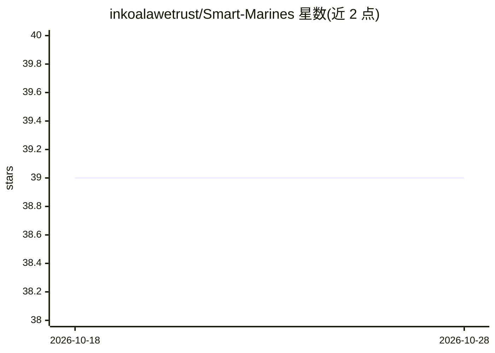

# inkoalawetrust/Smart-Marines

⭐ 39 · LGPL-2.1 · 推送 2025-12-16 · [GitHub](https://github.com/inkoalawetrust/Smart-Marines) · 个人维护

**Doom 智能海军陆战队员 NPC 模组资源**

面向 GZDoom 的 Doom 地图与模组资源，添加行为有别于原版怪物的海军陆战队员 NPC：按命中率切换单发/点射/全自动射击模式、投掷烟雾/破片/高爆手雷、撤退躲藏、翻越矮墙与跨越间隙、躲避来袭弹药、掩体利用、小队警戒传递与跟随指挥等。依赖 KAI 库运行（作者声明至少需较新版本直至完成）。行为可通过用户变量、CVAR 与出生别名配置。README 含功能未完成的 Todo 清单。

## 筛选速览

| 维度 | 判定 | 备注 |
|---|---|---|
| AI 角色 | `ai-enhanced` | 去掉 AI 部分产品仍成立 |
| 许可风险 | `viral` | LGPL-2.1 |
| 部署形态 | `None` |  |
| 模型依赖 | — | README 未给出锁定关系 |
| 硬件要求 | — | 无带数字的原话,不猜 |
| 安装摩擦 | `low` | 无编译、无系统依赖或容器化 |
| 成熟度 | `idea` | |

## 能力要点

- 按命中概率自动切换三种步枪射击模式与装填逻辑
- 可翻墙、下蹲、跳跃跨越间隙与主动寻找掩体
- 多类型手雷投掷与烟雾对怪物瞄准的影响
- 可通过用户变量配置颜色、护甲与行为，并提供 spawn 别名

## 适用场景

- 地图作者为地图集添加智能友军 NPC
- 模组作者将陆战队员作为可复用的 NPC 资源整合
- 玩家在 GZDoom 中使用 summon 命令生成特定配置的陆战队员

## 场景标签

 · 领域:游戏/模组开发

## 证据(README 行号)

> L5: Smart Marines are a drop in mod resource for mapsets and mods, that adds a very smart marine NPC (And more in the fu
> L1: >WARNING: THIS MOD REQUIRES THE KAI LIBRARY TO WORK AT ALL. PREFERRABLY THE LATEST RELEASES, AT LEAST UNTIL THE MARI

## 星数曲线

2026-10-18 39 → 2026-10-28 39（+0）

---
*卡片 v1 · prompt 1.4 · 生成 2026-10-25 · 置信度 mid · 依据 README sha `5bbac0c52afe` · [字段定义](../../DATASET.md)*
