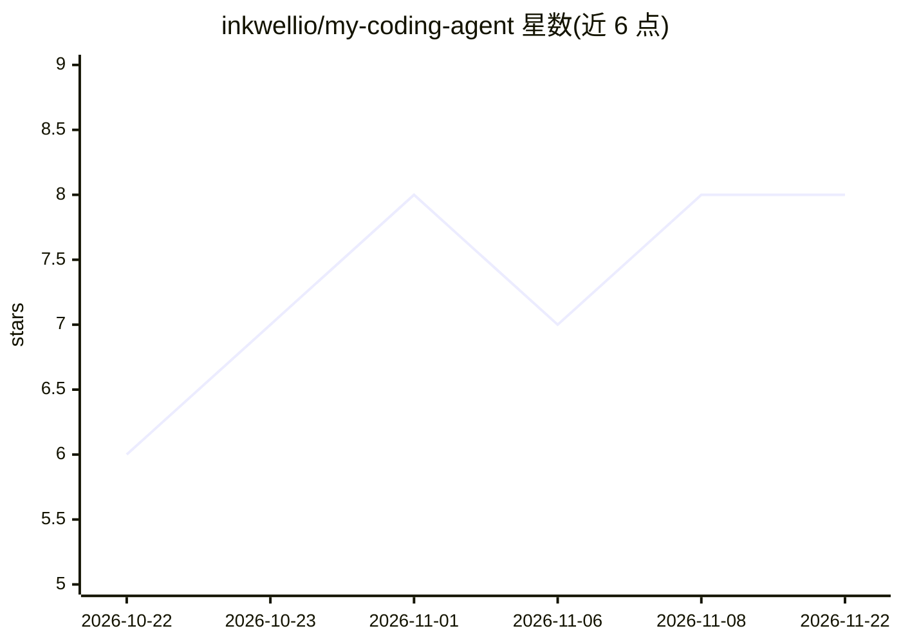

# inkwellio/my-coding-agent

⭐ 8 · TypeScript · MIT · 推送 2026-10-17 · [GitHub](https://github.com/inkwellio/my-coding-agent) · 个人维护 · 中文 README

**基于 Pi 引擎的桌面 AI 编程工作台**

非官方的桌面 AI 编程代理客户端，基于 Pi 编程代理引擎，以 Electron + React + TypeScript 构建。提供多工作区对话（RPC 模式驱动独立 pi 进程、流式输出、会话历史管理）、模型凭据管理、Git 差异查看/暂存/提交/分支切换/提交历史、MCP 服务器管理（stdio 与 Streamable HTTP）、可选命令沙盒与内置终端。从 Releases 下载 Windows/macOS/Linux 安装包无需 Node.js，或以 Node.js ≥ 22.19 从源码运行；安装包未签名；Git 功能需系统已装 Git。

## 筛选速览

| 维度 | 判定 | 备注 |
|---|---|---|
| AI 角色 | `ai-ecosystem` | LLM/agent 周边工具 |
| 许可风险 | `permissive` | MIT |
| 部署形态 | `desktop` | 安装包/桌面程序 |
| 模型依赖 | — | README 未给出锁定关系 |
| 硬件要求 | — | 无带数字的原话,不猜 |
| 安装摩擦 | `low` | 无编译、无系统依赖或容器化 |
| 成熟度 | — | 结构信号不足 |

## 能力要点

- 多工作区对话，每窗口驱动独立 pi 进程并流式显示回复与工具调用
- 内置提供商 API Key 管理，密钥仅存于 Pi AuthStorage，渲染进程只见脱敏信息
- Git 集成：差异查看、暂存提交、分支搜索/新建/检出、提交历史浏览
- MCP 服务器管理与可选命令沙盒（默认禁止外网访问）

## 适用场景

- 在桌面界面中管理多个工作区的 AI 编程会话
- 为 DeepSeek、Anthropic、OpenAI 等提供商集中管理 API Key
- 配合 AI 代理完成 Git 提交评审与分支操作
- 以沙盒方式隔离代理执行的 Shell 命令

## 场景标签

`编码 Agent` · 领域:编码与开发

## 证据(README 行号)

> L5: 基于 Pi 编程代理引擎的桌面 AI 编程工作台，使用 Electron + React + TypeScript 构建。
> L14: - **多工作区对话**：每个窗口通过 RPC 模式驱动独立的 `pi` 进程，流式显示助手回复与工具调用；支持轮次中途补充引导（steer），会话保存在 Pi 的本地会话存储中，可查看和删除历史会话。
> L15: - **模型凭据管理**：在界面中为内置提供商（如 DeepSeek、Anthropic、OpenAI、Gemini、OpenRouter 等）保存或清除 API Key；密钥只保存在主进程的 Pi AuthStorage 中，渲

## 星数曲线

2026-10-22 6 → 2026-11-22 8（+2）

---
*卡片 v1 · prompt 1.4 · 生成 2026-11-20 · 置信度 high · 依据 README sha `d1c1aee99dd0` · [字段定义](../../DATASET.md)*
