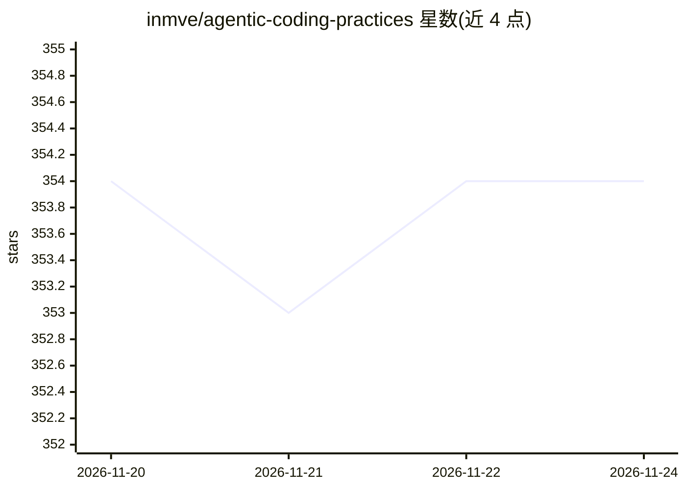

# inmve/agentic-coding-practices

⭐ 354 · 推送 2026-11-20 · [GitHub](https://github.com/inmve/agentic-coding-practices) · [官网](https://inmve.github.io/agentic-coding-practices/) · 个人维护

**AI 编程实践参考清单：为用 agent 开发软件者整理 127 条实践**

以参考清单形式收录 127 条使用 AI agent 编程的实践，来源为 256 篇从业者的文章，每条附原文引文，按规划、编码调试、测试验证、审查发布等 SDLC 阶段组织，每节内按时间新到旧排序。数据源为 data/entries.json，README 由其生成；另提供带悬停引文的站点版与供团队内部使用的 GitHub 模板调查。作者注明为初步版本，日期尚未核实。

## 筛选速览

| 维度 | 判定 | 备注 |
|---|---|---|
| AI 角色 | `ai-knowledge` | 知识聚合/清单类 |
| 许可风险 | `none` | — |
| 部署形态 | `None` |  |
| 模型依赖 | — | README 未给出锁定关系 |
| 硬件要求 | — | 无带数字的原话,不猜 |
| 安装摩擦 | `medium` | 含编译或系统依赖之一 |
| 成熟度 | `idea` | |

## 能力要点

- 127 条实践来自 256 个来源，每条附原文引文
- 按 SDLC 阶段组织，标注 22 条源自传统工程实践（如 CI、TDD）
- 包含 65 个示例图式
- 提供团队调查 GitHub 模板

## 适用场景

- 查找使用 AI agent 编程时可参考的团队实践
- 在团队内开展 agent 编程实践的调研讨论
- 了解 agent 时代软件工程流程的变化

## 场景标签

`精选清单` · 领域:学习与行业

## 证据(README 行号)

> L1: # Agentic software development reference
> L9: So I started again from what people who ship software with agents write about their own work. Below are 127 of their
> L15: - **Survey for your team:** team-survey, a GitHub template that asks the same practices inside your team

## 星数曲线

2026-11-20 354 → 2026-11-24 354（+0）

---
*卡片 v1 · prompt 1.4 · 生成 2026-11-20 · 置信度 high · 依据 README sha `77b468d7c9df` · [字段定义](../../DATASET.md)*
