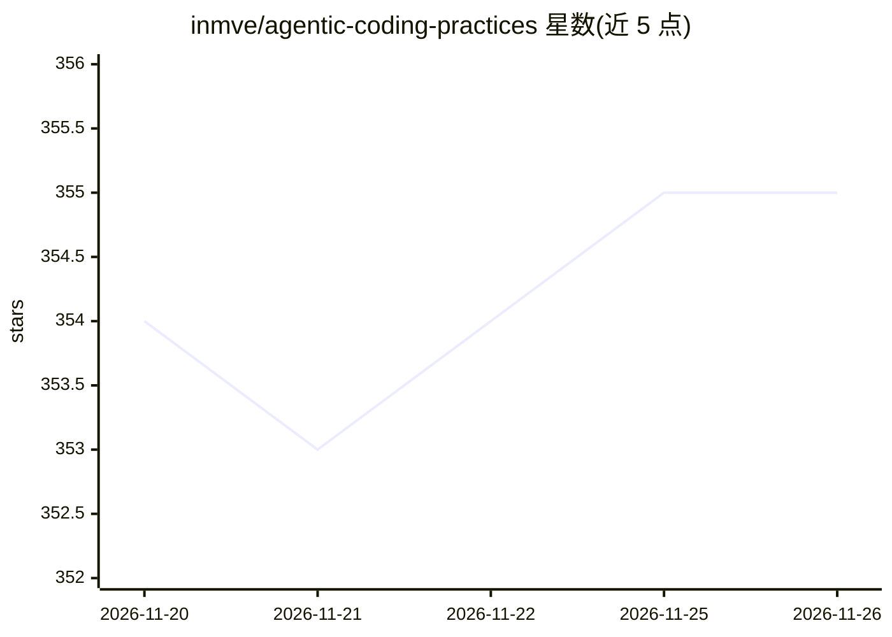

# inmve/agentic-coding-practices

⭐ 355 · 推送 2026-11-24 · [GitHub](https://github.com/inmve/agentic-coding-practices) · [官网](https://inmve.github.io/agentic-coding-practices/) · 个人维护

**面向用 AI 代理写代码的开发者的实践策展清单**

一份按软件开发生命周期阶段组织的代理编码实践清单：每条实践含定义、带日期的来源引用与逐字引文，部分条目标注其由哪些更早的工程实践演变而来（如 TDD、feature flags、tracer bullets）。内容覆盖规划原型、编码调试、测试验证、评审发布四个阶段，条目以最新在前排列，站点与 README 由同一 JSON 文件生成，并附 2026 年度调查问卷入口。

## 筛选速览

| 维度 | 判定 | 备注 |
|---|---|---|
| AI 角色 | `ai-knowledge` | 知识聚合/清单类 |
| 许可风险 | `none` | — |
| 部署形态 | `None` |  |
| 模型依赖 | — | README 未给出锁定关系 |
| 硬件要求 | — | 无带数字的原话,不猜 |
| 安装摩擦 | `medium` | 含编译或系统依赖之一 |
| 成熟度 | — | 结构信号不足 |

## 能力要点

- 按 SDLC 阶段组织实践条目，每条附带日期来源与逐字引文
- 标注实践与既有工程传统（如 TDD、KISS、feature flags）的演变关系
- README 与站点由单一 JSON 文件生成
- 配套 2026 年代理软件开发调查问卷

## 适用场景

- 为团队引入代理编码寻找可参考的实践模式
- 在测试、CI、代码评审环节规范 AI 代理的使用方式
- 了解从业者如何让代理参与调试、验证与告警处理

## 场景标签

`精选清单` · 领域:学习与行业

## 证据(README 行号)

> L3: Practices from people who build software with agents. Each entry has a definition, dated sources with a verbatim quo
> L20: ## Practices by SDLC stage

## 星数曲线

2026-11-20 354 → 2026-11-26 355（+1）

---
*卡片 v1 · prompt 1.4 · 生成 2026-11-25 · 置信度 high · 依据 README sha `ee305b731a22` · [字段定义](../../DATASET.md)*
