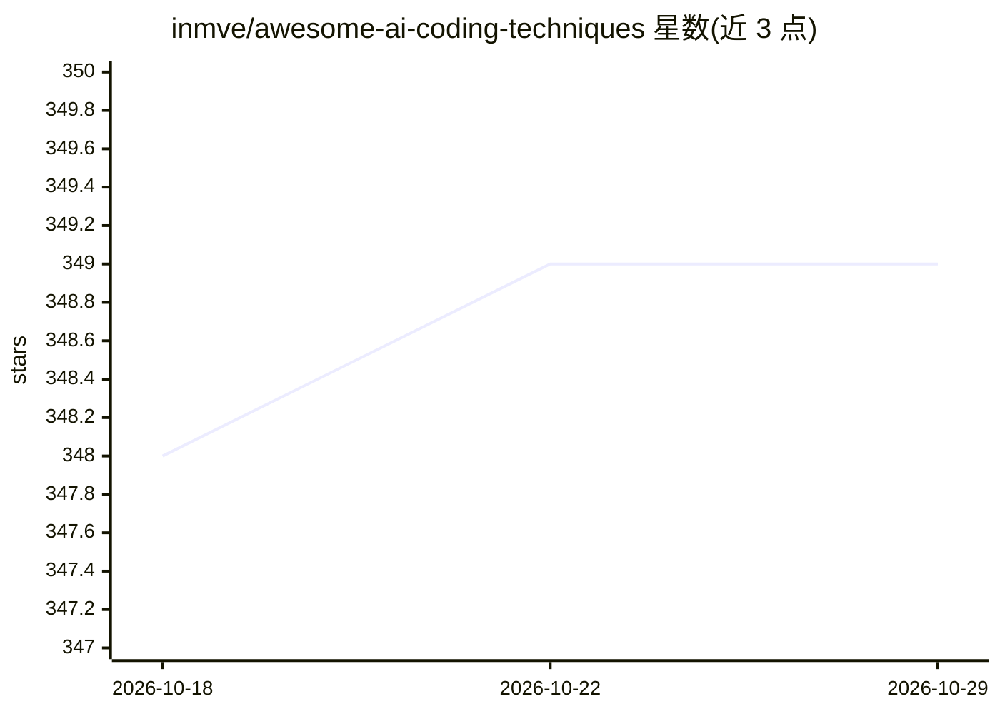

# inmve/awesome-ai-coding-techniques

⭐ 349 · 推送 2025-11-26 · [GitHub](https://github.com/inmve/awesome-ai-coding-techniques) · [官网](https://coding-with-ai.dev) · 个人维护

**AI 编程助手实用技巧合集：按开发阶段组织的实践清单**

社区维护的 awesome 清单，面向使用 AI 编程助力的开发者，按开发阶段（需求规划、UI 原型等）组织实践技巧，如记忆文件（CLAUDE.md/AGENTS.md）、先规划后编码、规格驱动开发、多方案对比等。技巧内容来自 Simon Willison 等从业者，并为 Claude Code、Cursor、Codex CLI 分别给出工具实现步骤，附社区采纳率投票数据（coding-with-ai.dev）。提供英、西、德、法、日、葡多语言版本。

## 筛选速览

| 维度 | 判定 | 备注 |
|---|---|---|
| AI 角色 | `ai-knowledge` | 知识聚合/清单类 |
| 许可风险 | `none` | — |
| 部署形态 | `None` |  |
| 模型依赖 | — | README 未给出锁定关系 |
| 硬件要求 | — | 无带数字的原话,不猜 |
| 安装摩擦 | `low` | 无编译、无系统依赖或容器化 |
| 成熟度 | — | 结构信号不足 |

## 能力要点

- 按开发阶段组织的 AI 编程实践技巧
- 为 Claude Code / Cursor / Codex CLI 分别给出具体操作步骤
- 技巧附社区采纳率投票数据（样本数标注）
- 多语言 README（英/西/德/法/日/葡）

## 适用场景

- 配置 CLAUDE.md / AGENTS.md 等记忆文件规范助手行为
- 学习先规划后实现的 AI 编程工作流
- 为团队沉淀 AI 编程助手的协作规范

## 场景标签

`精选清单` · 领域:学习与行业

## 证据(README 行号)

> L9: # Awesome AI Coding Techniques
> L11: **Practical techniques for coding with AI - Community-driven and practitioner-tested**
> L13: This resource organizes techniques for working with coding assistants by development stage (from requirements and p

## 星数曲线

2026-10-18 348 → 2026-10-29 349（+1）

---
*卡片 v1 · prompt 1.4 · 生成 2026-10-21 · 置信度 high · 依据 README sha `36d92a155c0b` · [字段定义](../../DATASET.md)*
