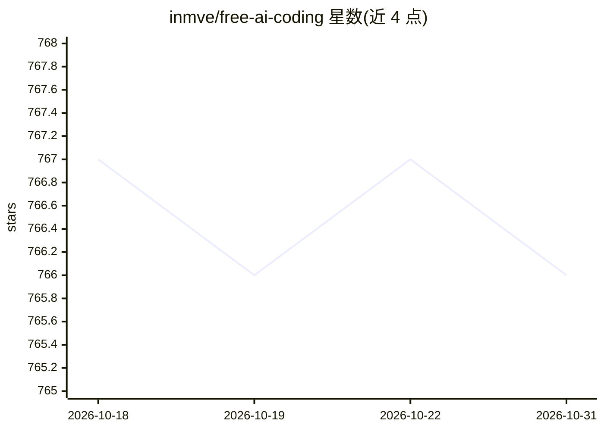

# inmve/free-ai-coding

⭐ 766 · 推送 2026-09-26 · [GitHub](https://github.com/inmve/free-ai-coding) · 个人维护

**追踪 AI 编码工具额度重置与额外用量的信息清单**

一个信息跟踪仓库，记录 Codex/OpenAI、Claude Code/Anthropic、Gk Bot/xAI 三类 AI 编码工具的使用额度重置公告与确认状态，均附原始来源链接与时间戳。提供基于 GitHub Releases 的通知机制：用户通过 Watch→Custom→Releases 订阅特定工具的重置提醒。README 以状态表形式呈现各项最新公告与未确认事项，另指向外部查询网站。无代码安装与运行内容。

## 筛选速览

| 维度 | 判定 | 备注 |
|---|---|---|
| AI 角色 | `ai-knowledge` | 知识聚合/清单类 |
| 许可风险 | `none` | — |
| 部署形态 | `None` |  |
| 模型依赖 | — | README 未给出锁定关系 |
| 硬件要求 | — | 无带数字的原话,不猜 |
| 安装摩擦 | `low` | 无编译、无系统依赖或容器化 |
| 成熟度 | — | 结构信号不足 |

## 能力要点

- 跟踪 Codex、Claude Code、Grok Bot 三类工具的额度重置公告
- 每条记录附原始来源与时间戳
- 通过 GitHub Releases 订阅按工具定制的重置通知

## 适用场景

- 订阅 AI 编码工具额度重置的通知提醒
- 查阅各工具最近一次额度重置公告与原始来源

## 场景标签

`精选清单` · 领域:学习与行业

## 证据(README 行号)

> L7: - Codex reset alerts
> L8: - Claude Code reset alerts
> L9: - Grok Bot reset alerts
> L15: ## Current status

## 星数曲线

2026-10-18 767 → 2026-10-31 766（-1）

---
*卡片 v1 · prompt 1.4 · 生成 2026-10-21 · 置信度 high · 依据 README sha `7c28c748042a` · [字段定义](../../DATASET.md)*
