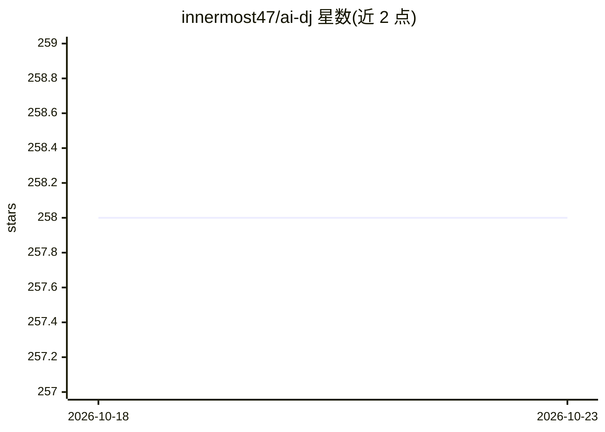

# innermost47/ai-dj

⭐ 258 · C++ · NOASSERTION · 推送 2026-09-27 · [GitHub](https://github.com/innermost47/ai-dj) · 个人维护

**现场演出用 AI 音乐循环生成插件（VST3/AU/独立版）**

面向现场演出与 DAW 工作流的 AI 音乐生成插件：输入文字提示生成乐句循环，配 8 轨采样器、16 步序列器、每轨效果链（EQ/压缩/失真/延迟/混响等）与 MIDI 映射。本地 CPU 引擎使用 Stable Audio 3 Medium，完全离线运行；另支持通过自托管 GPU 服务器接入 9 个专用生成引擎（NVIDIA CUDA 或 Apple Silicon）。提供 VST3/AU/独立版，支持 Ableton Link 同步。作者声明其非整曲生成器，需用户自行编排构建作品。

## 筛选速览

| 维度 | 判定 | 备注 |
|---|---|---|
| AI 角色 | `ai-native` | 本体是模型或模型工具 |
| 许可风险 | `none` | NOASSERTION |
| 部署形态 | `desktop` | 安装包/桌面程序 |
| 模型依赖 | — | README 未给出锁定关系 |
| 硬件要求 | — | 无带数字的原话,不猜 |
| 安装摩擦 | `medium` | 含编译或系统依赖之一 |
| 成熟度 | `idea` | |

## 能力要点

- 文字提示生成乐句循环，8 轨采样器 + 256 个序列模式
- Stable Audio 3 Medium 本地 CPU 推理，完全离线
- 9 个 GPU 专用引擎经自托管 obsidian-neural-gpu-server 接入
- VST3/AU/独立版，支持 Ableton Link 与 MIDI 触发

## 适用场景

- 现场演出中实时生成并触发 AI 乐句循环
- 在 DAW 内按提示词生成采样素材并混音编排
- 离线环境下做 AI 辅助的音乐创作

## 场景标签

 · 领域:音乐制作/音频软件

## 证据(README 行号)

> L58: Type words → Get musical loops. No stopping your creative flow.
> L95: - **Local CPU generation** with Stable Audio 3 Medium - fully offline
> L123: **OBSIDIAN Neural is NOT a song generator** like Suno or Udio. It's a performance tool: you build your track loop 

## 星数曲线

2026-10-18 258 → 2026-10-23 258（+0）

---
*卡片 v1 · prompt 1.4 · 生成 2026-10-22 · 置信度 high · 依据 README sha `fad35f00ce41` · [字段定义](../../DATASET.md)*
