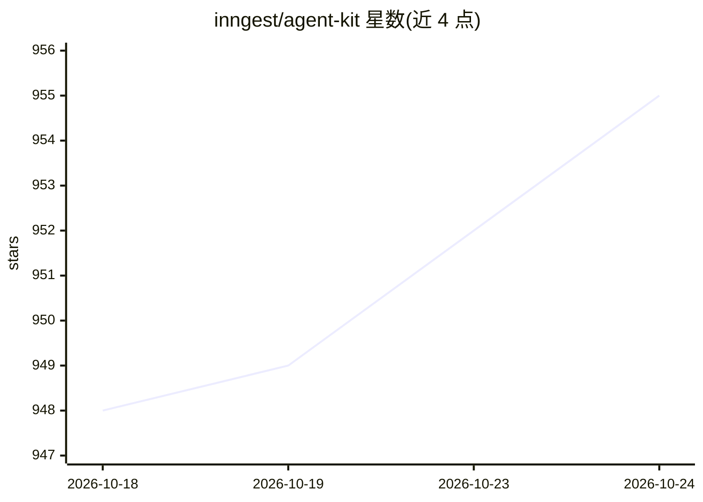

# inngest/agent-kit

⭐ 955 · TypeScript · Apache-2.0 · 推送 2026-04-29 · [GitHub](https://github.com/inngest/agent-kit) · [官网](https://agentkit.inngest.com) · 组织维护

**TypeScript 多智能体网络框架：确定性路由与 MCP 工具**

面向 TypeScript 开发者的多 Agent 网络构建库（npm 包 @inngest/agent-kit）。核心概念包括 Agent（LLM 调用+提示/工具/MCP）、共享状态的 Network、结合状态机的 State，以及从代码路由到 LLM 路由（如 ReAct、Supervisor 模式）的 Router；内置 Tracing 用于本地与云端调试。通过 MCP 接入工具，配合 Inngest Dev Server 本地运行，部署后获得容错编排。限制：v0.9.0 起需将 inngest 作为独立依赖安装。

## 筛选速览

| 维度 | 判定 | 备注 |
|---|---|---|
| AI 角色 | `ai-ecosystem` | LLM/agent 周边工具 |
| 许可风险 | `permissive` | Apache-2.0 |
| 部署形态 | `library` | 以包/库形式分发 |
| 模型依赖 | — | README 未给出锁定关系 |
| 硬件要求 | — | 无带数字的原话,不猜 |
| 安装摩擦 | `low` | 无编译、无系统依赖或容器化 |
| 成熟度 | — | 结构信号不足 |

## 能力要点

- 基于共享 State 的确定性路由（代码路由与 Agent 路由）
- 支持 MCP 作为工具来源，可接入 Smithery 或自托管 MCP server
- 内置 Tracing，本地与云端调试工作流
- 配合 Inngest 编排引擎，部署后 Agent 容错

## 适用场景

- 用 TypeScript 构建多 Agent 协作网络
- 需要代码级可控路由的 Agent 编排
- 通过 MCP server 为 Agent 扩充工具

## 场景标签

`Agent 框架` `多智能体` · 领域:Agent 开发

## 证据(README 行号)

> L13: AgentKit offers more deterministic and flexible routing, works with multiple model providers, embraces MCP (for ric
> L17: - **Agents**: LLM calls that can be combined with prompts, tools, and MCP.
> L20: - **Routers**: where the autonomy lives, from code-based to LLM-based (ex: ReAct) orchestration

## 星数曲线

2026-10-18 948 → 2026-10-24 955（+7）

---
*卡片 v1 · prompt 1.4 · 生成 2026-10-21 · 置信度 high · 依据 README sha `fba54775deb6` · [字段定义](../../DATASET.md)*
