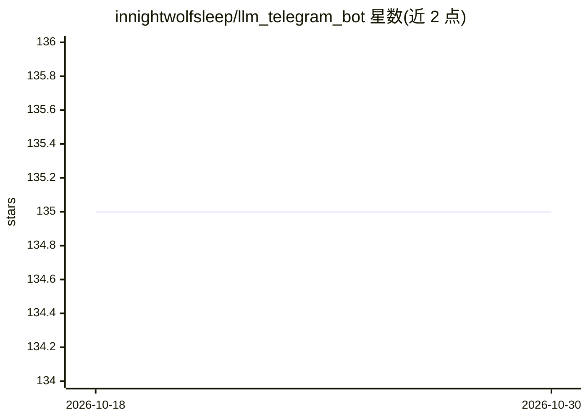

# innightwolfsleep/llm_telegram_bot

⭐ 135 · Python · MIT · 推送 2026-09-29 · [GitHub](https://github.com/innightwolfsleep/llm_telegram_bot) · 个人维护

**把本地 LLM 接入 Telegram 的聊天机器人（独立应用/扩展）**

基于 aiogram 的 Telegram 聊天机器人：以独立应用运行时封装 llama.cpp（默认）、exllama/exllamav2、transformers、llama.cpp server，或以扩展模式接入 oobabooga/text-generation-webui，也可对接 Ollama。功能含角色/前缀消息操作、会话历史持久化、SD API 生图、silero 语音生成与自动翻译。用户需从 BotFather 获取 token，放入模型文件并配置 app_config.json 后以脚本启动；扩展模式需先安装 text-generation-webui。

## 筛选速览

| 维度 | 判定 | 备注 |
|---|---|---|
| AI 角色 | `ai-native` | 本体是模型或模型工具 |
| 许可风险 | `permissive` | MIT |
| 部署形态 | `library` | 以包/库形式分发 |
| 模型依赖 | local-ok | 支持本地模型 |
| 硬件要求 | — | 无带数字的原话,不猜 |
| 安装摩擦 | `low` | 无编译、无系统依赖或容器化 |
| 成熟度 | — | 结构信号不足 |

## 能力要点

- 支持 llama.cpp/exllama/exllamav2/transformers/ollama 多种本地推理后端
- 可作 text-generation-webui 扩展或独立应用运行
- Telegram 内角色切换、impersonate、历史管理等聊天操作前缀
- 集成 SD API 生图、silero 语音生成、自动翻译

## 适用场景

- 在 Telegram 里与本地部署的 LLM 对话
- 为 text-generation-webui 添加 Telegram 前端
- 多用户隔离会话、按白名单控制访问的私聊机器人

## 场景标签

`聊天机器人` · 领域:对话与助手

## 证据(README 行号)

> L3: - wrAPPer for llama.cpp(default), exllama or transformers.
> L13: Provide telegram chat with various additional functional like buttons, prefixes, voice/image generation.

## 星数曲线

2026-10-18 135 → 2026-10-30 135（+0）

---
*卡片 v1 · prompt 1.4 · 生成 2026-10-23 · 置信度 high · 依据 README sha `c51e8f45de42` · [字段定义](../../DATASET.md)*
