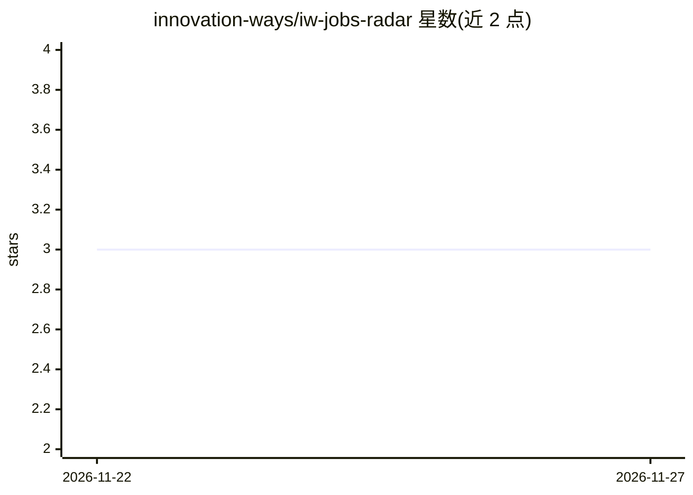

# innovation-ways/iw-jobs-radar

⭐ 3 · Python · Apache-2.0 · 推送 2026-11-01 · [GitHub](https://github.com/innovation-ways/iw-jobs-radar) · 个人维护

**本地优先的求职雷达：按个人画像追踪与打分职位**

自托管应用：追踪关注公司的招聘页（Greenhouse/Lever/Ashby 等板）与公共职位板，新职位由本地 AI 模型阅读并按维度抽取证据（栈、地点、薪资），再经固定规则与用户设定的权重确定打分，去重后进入个人收件箱，每条分数可溯源到引用段落。提供趋势视图展示技术与职位族随时间变化。AI 默认关闭，职位分析仅本地（Ollama），远程 AI 仅限经同意的 CV 导入。Docker 部署，仅发布到 127.0.0.1，v1 无身份认证。

## 筛选速览

| 维度 | 判定 | 备注 |
|---|---|---|
| AI 角色 | `ai-native` | 本体是模型或模型工具 |
| 许可风险 | `permissive` | Apache-2.0 |
| 部署形态 | `self-host` | docker 或自建部署 |
| 模型依赖 | local-ok | 支持本地模型 |
| 硬件要求 | — | 无带数字的原话,不猜 |
| 安装摩擦 | `low` | 无编译、无系统依赖或容器化 |
| 成熟度 | — | 结构信号不足 |

## 能力要点

- 本地 AI 读取职位并引用证据段落，最终分数为确定性函数（无模型参与）
- CV 导入仅生成逐条可审阅的提议，上传的 CV 不存储
- 可选 MCP server 让 Claude Code 等 agent 读取收件箱、解释分数
- 趋势视图按周展示相关职位的技术与职位族变化

## 适用场景

- 关注目标公司，有新职位时收到带理由的相关性排序收件箱
- 用自定义规则自动剔除不符合条件的职位
- 追踪自己领域的技术与岗位需求趋势

## 场景标签

 · 领域:职业/求职工具

## 证据(README 行号)

> L14: Every score can be explained. A local AI model reads each offer and quotes the passages that matter, such as the st
> L22: - **Sources**: company boards (Greenhouse, Lever, Ashby, SmartRecruiters, Eightfold) and job boards

## 星数曲线

2026-11-22 3 → 2026-11-27 3（+0）

---
*卡片 v1 · prompt 1.4 · 生成 2026-11-22 · 置信度 high · 依据 README sha `d8141adf51b7` · [字段定义](../../DATASET.md)*
