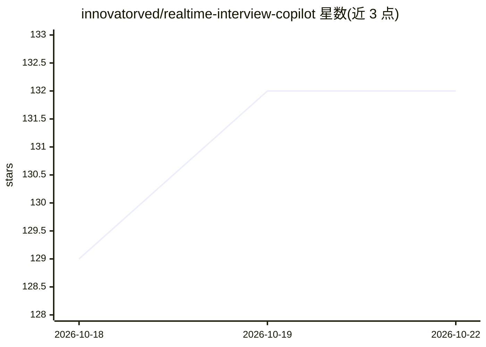

# innovatorved/realtime-interview-copilot

⭐ 132 · TypeScript · Apache-2.0 · 推送 2026-09-13 · [GitHub](https://github.com/innovatorved/realtime-interview-copilot) · 个人维护

**桌面应用：实时转录面试音频并生成 AI 回答**

面向求职者的桌面面试辅助应用：捕获系统音频做实时转写，基于转写文本、手动输入的问题或截图生成 AI 回答；提供画中画紧凑模式（点击穿透）、窗口透明度调节、隐藏于常规屏幕共享、快捷键与应用内更新。macOS 无需虚拟音频驱动，Windows 构建未签名，首次启动需授予屏幕录制与麦克风权限。支持 Homebrew、WinGet 与 GitHub Releases 安装。

## 筛选速览

| 维度 | 判定 | 备注 |
|---|---|---|
| AI 角色 | `ai-native` | 本体是模型或模型工具 |
| 许可风险 | `permissive` | Apache-2.0 |
| 部署形态 | `desktop` | 安装包/桌面程序 |
| 模型依赖 | — | README 未给出锁定关系 |
| 硬件要求 | — | 无带数字的原话,不猜 |
| 安装摩擦 | `low` | 无编译、无系统依赖或容器化 |
| 成熟度 | — | 结构信号不足 |

## 能力要点

- 系统音频实时转写（macOS 无需虚拟音频驱动）
- AI 回答来源：转写文本、输入问题或截图
- 画中画紧凑模式，空白区域点击穿透到下层应用
- 通过 contentProtection 对常规屏幕共享隐藏窗口

## 适用场景

- 在线面试中实时获取问题转写与回答建议
- 以悬浮窗形式在不切换窗口的前提下查看 AI 输出
- 对屏幕或输入内容提问并获得回答

## 场景标签

`语音识别` · 领域:感知与多模态

## 证据(README 行号)

> L3: Desktop app for live interview assistance. It captures system audio, transcribes speech in real time, and can answer
> L63: - Live transcription of system audio (no virtual audio driver required on macOS)
> L64: - AI answers from transcript, typed questions, or screenshots

## 星数曲线

2026-10-18 129 → 2026-10-22 132（+3）

---
*卡片 v1 · prompt 1.4 · 生成 2026-10-22 · 置信度 high · 依据 README sha `059d60d7ea3b` · [字段定义](../../DATASET.md)*
