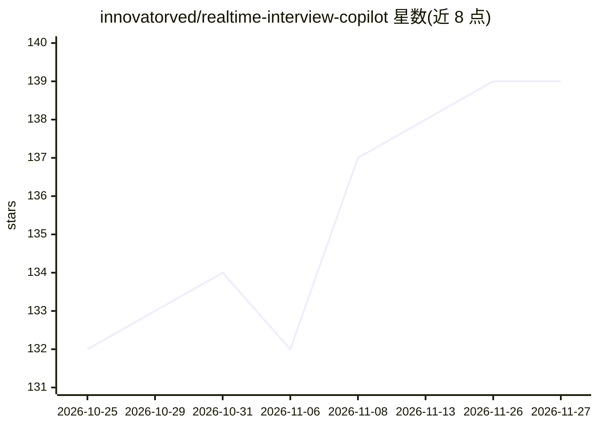

# innovatorved/realtime-interview-copilot

⭐ 139 · TypeScript · Apache-2.0 · 推送 2026-11-05 · [GitHub](https://github.com/innovatorved/realtime-interview-copilot) · 个人维护

**实时转写面试音频并用 AI 生成应答的桌面辅助应用**

Electron 桌面应用：捕获系统音频并实时转写，基于转写内容、手动输入的问题或截图生成 AI 回答，用于面试过程中的实时应答辅助。提供画中画紧凑模式、透明度调节、屏幕共享隐藏（contentProtection）、按键说话麦克风、全局快捷键与截图附件等功能。macOS 通过 Homebrew Cask 安装，Windows 提供 WinGet 脚本安装（构建未签名，SmartScreen 会提示），也可从 GitHub Releases 手动下载；源码开发需 Node 22+ 与 Bun 1.3+。

## 筛选速览

| 维度 | 判定 | 备注 |
|---|---|---|
| AI 角色 | `ai-native` | 本体是模型或模型工具 |
| 许可风险 | `permissive` | Apache-2.0 |
| 部署形态 | `desktop` | 安装包/桌面程序 |
| 模型依赖 | — | README 未给出锁定关系 |
| 硬件要求 | — | 无带数字的原话,不猜 |
| 安装摩擦 | `low` | 无编译、无系统依赖或容器化 |
| 成熟度 | — | 结构信号不足 |

## 能力要点

- 实时转写系统音频，macOS 无需虚拟音频驱动
- 基于转写、输入问题或截图生成 AI 回答
- 画中画紧凑模式与屏幕共享隐藏
- Homebrew Cask / WinGet 安装与手动下载包

## 适用场景

- 线上面试中获得实时应答建议
- 对转写内容做摘要整理
- 以截图形式提问并获取回答

## 场景标签

`语音识别` · 领域:感知与多模态

## 证据(README 行号)

> L3: Desktop app for live interview assistance. It captures system audio, transcribes speech in real time, and can answer
> L64: - AI answers from transcript, typed questions, or screenshots

## 星数曲线

2026-10-25 132 → 2026-11-27 139（+7）

---
*卡片 v1 · prompt 1.4 · 生成 2026-11-27 · 置信度 high · 依据 README sha `298d6af0a4ea` · [字段定义](../../DATASET.md)*
