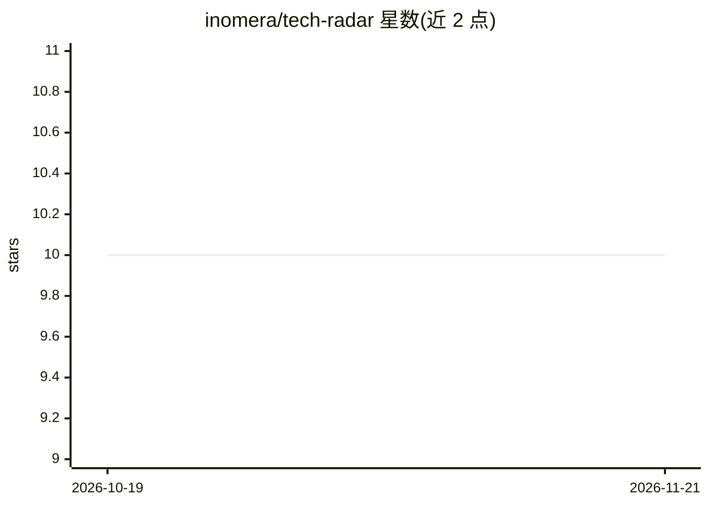

# inomera/tech-radar

⭐ 10 · MIT · 推送 2026-01-19 · [GitHub](https://github.com/inomera/tech-radar) · 组织维护

**企业技术选型雷达的可视化生成工具**

Inomera 用于生成其公开技术雷达（Tech Radar）可视化页面的代码仓库，基于 d3.js v4 实现雷达图渲染，源码派生自 Zalando SE，受 ThoughtWorks 技术雷达启发。使用者通过引入 d3.js 与 radar.js、插入 svg 标签并配置 radar_visualization 参数即可生成雷达图，条目位置自动排布以避免重叠；仓库附带 docs/index.html 示例，本地开发使用 yarn/npm 安装依赖并启动开发服务器。

## 筛选速览

| 维度 | 判定 | 备注 |
|---|---|---|
| AI 角色 | `ai-knowledge` | 知识聚合/清单类 |
| 许可风险 | `permissive` | MIT |
| 部署形态 | `None` |  |
| 模型依赖 | — | README 未给出锁定关系 |
| 硬件要求 | — | 无带数字的原话,不猜 |
| 安装摩擦 | `low` | 无编译、无系统依赖或容器化 |
| 成熟度 | — | 结构信号不足 |

## 能力要点

- 基于 d3.js v4 的雷达图可视化生成
- 条目位置自动排布避免重叠
- 提供 docs/index.html 可运行的公开技术雷达示例
- 本地开发支持 yarn/npm 安装与开发服务器

## 适用场景

- 为团队维护公开的技术选型雷达页面
- 以雷达图形式展示组织内技术的采用/评估状态

## 场景标签

 · 领域:开发者工具/技术管理

## 证据(README 行号)

> L3: At Inomera, we maintain a [public Tech
> L8: This repository contains the code to generate the visualization:

## 星数曲线

2026-10-19 10 → 2026-11-21 10（+0）

---
*卡片 v1 · prompt 1.4 · 生成 2026-11-19 · 置信度 mid · 依据 README sha `cbd740a7a4be` · [字段定义](../../DATASET.md)*
