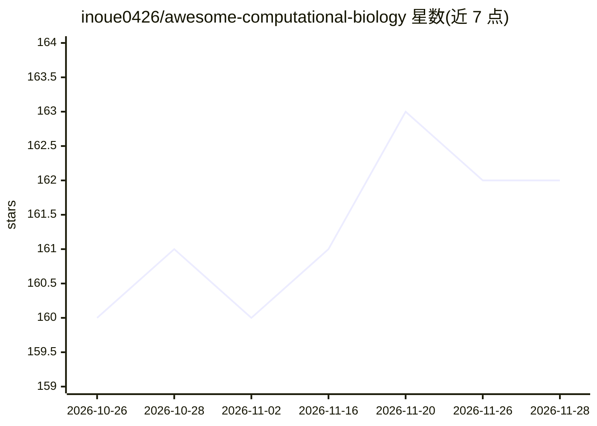

# inoue0426/awesome-computational-biology

⭐ 162 · Python · CC0-1.0 · 推送 2026-11-23 · [GitHub](https://github.com/inoue0426/awesome-computational-biology) · 个人维护

**计算生物学数据库、软件与论文的资源清单**

面向计算生物学研究者的资源目录，收录数据库、软件与论文，按单细胞 RNA、化合物、通路、蛋白质、基因组、疾病、相互作用、临床试验等类别组织，并提供 GitHub Pages 界面与 Dataset Explorer、Method Explorer、Foundation Model Explorer、Agent Explorer 等比较工具，支持按任务、模态、年份等条件过滤与搜索；可通过脚本重新生成资源概览图。

## 筛选速览

| 维度 | 判定 | 备注 |
|---|---|---|
| AI 角色 | `ai-knowledge` | 知识聚合/清单类 |
| 许可风险 | `viral` | CC0-1.0 |
| 部署形态 | `None` |  |
| 模型依赖 | — | README 未给出锁定关系 |
| 硬件要求 | — | 无带数字的原话,不猜 |
| 安装摩擦 | `low` | 无编译、无系统依赖或容器化 |
| 成熟度 | — | 结构信号不足 |

## 能力要点

- 按多个生物学类别组织的数据库清单
- 提供 Dataset/Method/Foundation Model/Agent 四类 Explorer 比较表
- GitHub Pages 界面支持搜索与过滤
- 附 Python 脚本可重新生成资源概览图

## 适用场景

- 查找特定领域的生物学数据库
- 比较药物响应与扰动建模方法
- 检索基础模型与 agent 系统的资源信息

## 场景标签

`精选清单` · 领域:学习与行业

## 证据(README 行号)

> L3: A curated collection of databases, software, and papers related to computational biology.
> L24: The Agent Explorer compares agentic AI systems by scientific domain, single- vs multi-agent architecture, tool/code

## 星数曲线

2026-10-26 160 → 2026-11-28 162（+2）

---
*卡片 v1 · prompt 1.4 · 生成 2026-11-27 · 置信度 high · 依据 README sha `36c4cedfd42e` · [字段定义](../../DATASET.md)*
