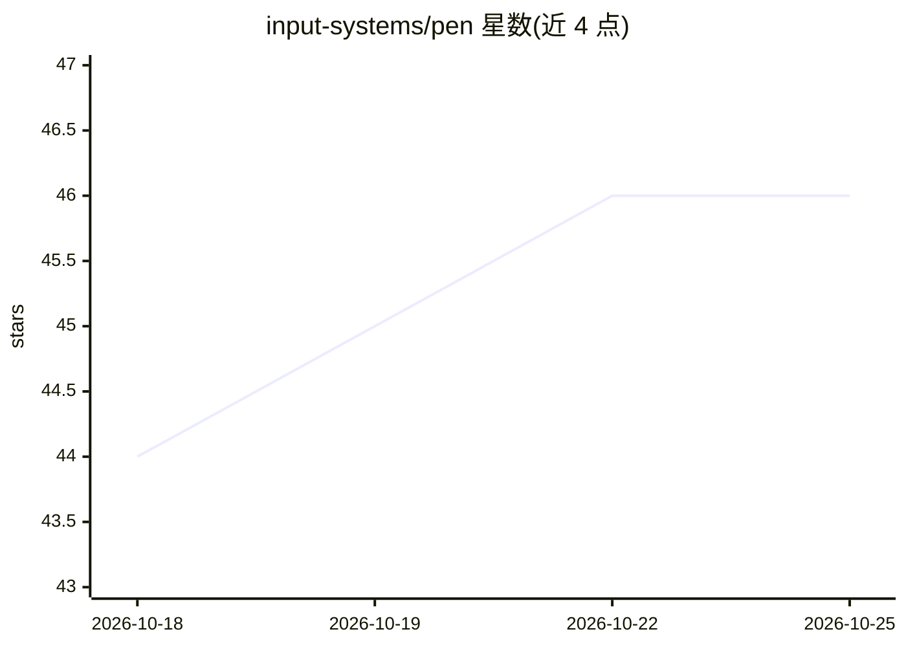

# input-systems/pen

⭐ 46 · TypeScript · MIT · 推送 2026-10-22 · [GitHub](https://github.com/input-systems/pen) · [官网](https://www.npmjs.com/package/@input/pen) · 组织维护

**面向人类与 AI 协同写作的无头富文本编辑器 SDK**

块结构富文本编辑器 SDK，运行时无头：持有文档、选区与历史，渲染交由宿主。文档自第一键起即 Yjs CRDT，协作只需加 presence 与传输层。所有修改（按键、粘贴、AI 重写、远端用户）统一走 DocumentOp 与 editor.apply，origins 标注作者；AI 修改可落地为可逐条接受/拒绝的建议，与人类共享撤销栈。aiExtension 需自备 ModelAdapter，不捆绑 provider SDK、不持有 API key。支持 Node 无 DOM 运行、HTML/Markdown/JSON/XML 导入导出，以多个 npm 包分发，提供 React/Vue/DOM 绑定与 playground。

## 筛选速览

| 维度 | 判定 | 备注 |
|---|---|---|
| AI 角色 | `ai-ecosystem` | LLM/agent 周边工具 |
| 许可风险 | `permissive` | MIT |
| 部署形态 | `library` | 以包/库形式分发 |
| 模型依赖 | — | README 未给出锁定关系 |
| 硬件要求 | — | 无带数字的原话,不猜 |
| 安装摩擦 | `low` | 无编译、无系统依赖或容器化 |
| 成熟度 | — | 结构信号不足 |

## 能力要点

- 统一写入路径：按键、粘贴、AI 重写、远端协作均经 DocumentOp 与 apply 流水线
- AI 修改以 origin 标注，可落地为可审阅、可撤销、可归属的建议
- 文档自第一键起为 Yjs CRDT，协作只需叠加 presence 与传输层
- createHeadlessEditor 支持无 DOM 的 Node 运行时，用于服务端与 agent 工作流

## 适用场景

- 构建人与 AI 共写同一文档的编辑器应用
- 为 AI 改写结果实现逐条审阅、接受/拒绝的交互
- 在服务器或 agent 流水线中无头编辑与导出文档

## 场景标签

 · 领域:前端/编辑器 SDK

## 证据(README 行号)

> L17: **AI is a writer, not a plugin.** Origins record who wrote each change, so a model can stream into the document, la
> L129: By default AI edits land as tracked suggestions for a review UI; `mutationPreference: "direct"` applies them immed

## 星数曲线

2026-10-18 44 → 2026-10-25 46（+2）

---
*卡片 v1 · prompt 1.4 · 生成 2026-10-25 · 置信度 high · 依据 README sha `59a60606dab7` · [字段定义](../../DATASET.md)*
