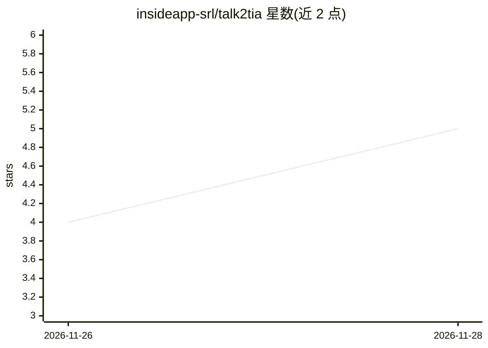

# insideapp-srl/talk2tia

⭐ 5 · C# · NOASSERTION · 推送 2026-11-26 · [GitHub](https://github.com/insideapp-srl/talk2tia) · [官网](https://talk2tia.insideapp.it) · 组织维护

**MCP 服务器：让 AI 助手通过 Openness 操作 TIA Portal 工程**

面向西门子 TIA Portal V21 的 MCP 服务器（MIT，公开测试版 v0.12.0），通过官方 Openness API 向 Claude Code、Claude Desktop 等 MCP 客户端暴露 123 个工具，支持以自然语言读写 SCL 源码与 LAD/FBD、管理库与标签表、编译定位错误、在线/离线比较与受控下载，并以统一 diff 呈现每次修改。破坏性操作需显式确认，支持配置文件限制可用工具集或只读模式。Windows 提供 MSI 安装包，源码构建需本机安装 TIA Portal V21。

## 筛选速览

| 维度 | 判定 | 备注 |
|---|---|---|
| AI 角色 | `ai-ecosystem` | LLM/agent 周边工具 |
| 许可风险 | `permissive` | NOASSERTION |
| 部署形态 | `desktop` | 安装包/桌面程序 |
| 模型依赖 | locked-api |  |
| 硬件要求 | — | 无带数字的原话,不猜 |
| 安装摩擦 | `medium` | 含编译或系统依赖之一 |
| 成熟度 | `idea` | |

## 能力要点

- 123 个 MCP 工具覆盖 PLC 代码、库、标签、编译与诊断
- 每次修改返回 diff：SCL 统一 diff、LAD/FBD 网络前后图
- 可配置工具集或只读模式，破坏性操作需显式确认
- 通过 CPU Web API 读取诊断缓冲、报警与实时变量

## 适用场景

- 用 Claude Code 以自然语言修改 SCL 与 LAD 块
- 批量编辑标签表、常量与 UDT
- 编译后按定位查看错误并做在线/离线比较
- 在测试工程中让 AI 助手协助 PLC 程序调整

## 场景标签

 · 领域:工业自动化/开发工具

## 证据(README 行号)

> L5:  Talk to TIA Portal. An MCP server that lets your AI assistant work inside Siemens TIA Portal V21 through the offici
> L24: Talk2Tia exposes **123 MCP tools** to Claude Code, Claude Desktop or any MCP client, so you can work on a TIA Porta

## 星数曲线

2026-11-26 4 → 2026-11-28 5（+1）

---
*卡片 v1 · prompt 1.4 · 生成 2026-11-26 · 置信度 high · 依据 README sha `03552d3499b9` · [字段定义](../../DATASET.md)*
