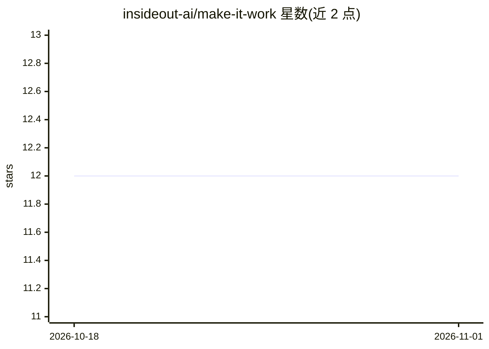

# insideout-ai/make-it-work

⭐ 12 · JavaScript · NOASSERTION · 推送 2026-10-30 · [GitHub](https://github.com/insideout-ai/make-it-work) · [官网](https://insideoutai.io/) · 组织维护

**面向 Claude Code 的代码库上下文与需求工程命令集**

一组运行在 Claude Code 内的斜杠命令，服务于大型遗留代码库上的工程团队：go-deep 扫描代码库生成结构化知识库（architecture.md/product.md 与按领域和用例组织的 skill 文件、交叉引用图），define-test-strategy 生成测试策略 skill 与 test-map 映射，run-regression 按用例/领域 token 执行回归套件，drive-the-epic 编排从想法/文档/Jira 工单到需求与切片的全流程并产出可恢复的离线 HTML 仪表盘。知识库通过 CLAUDE.md 规则在每次提交前强制与代码同步。

## 筛选速览

| 维度 | 判定 | 备注 |
|---|---|---|
| AI 角色 | `ai-ecosystem` | LLM/agent 周边工具 |
| 许可风险 | `none` | NOASSERTION |
| 部署形态 | `None` |  |
| 模型依赖 | locked-api |  |
| 硬件要求 | — | 无带数字的原话,不猜 |
| 安装摩擦 | `low` | 无编译、无系统依赖或容器化 |
| 成熟度 | — | 结构信号不足 |

## 能力要点

- go-deep 生成架构/产品文档与按领域、用例组织的 skill 及交叉引用图
- CLAUDE.md 强制规则：每次提交前检查并更新知识库保持同步
- define-test-strategy 维护用例/领域到测试的跨仓库映射与分层覆盖率报告
- drive-the-epic 产出可恢复进度、离线 HTML 仪表盘与需求/切片文档

## 适用场景

- 让 Claude 在大型遗留代码库上工作前建立项目上下文
- 把工单/想法转成结构化需求并切片为可实施的工作
- 按用例与领域 token 运行跨仓库回归测试
- 维护与代码同步的领域和用例文档供团队与 PM 使用

## 场景标签

`知识库管理` · 领域:知识与检索

## 证据(README 行号)

> L3: > From idea to delivery: make your codebase AI-ready with context skills, shape requirements, slice work, plan imple
> L17: `go-deep` maps your codebase and builds a structured knowledge base that Claude loads before doing any work:
> L66: Orchestrates **source intake → shape-the-epic → full-epic review → slice-the-epic**, with saved, resumable progress

## 星数曲线

2026-10-18 12 → 2026-11-01 12（+0）

---
*卡片 v1 · prompt 1.4 · 生成 2026-11-01 · 置信度 high · 依据 README sha `7c74506a4a6f` · [字段定义](../../DATASET.md)*
