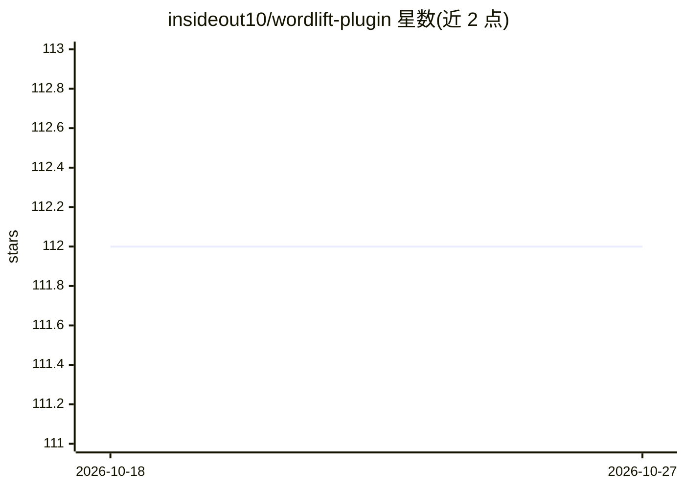

# insideout10/wordlift-plugin

⭐ 112 · PHP · GPL-2.0 · 推送 2026-10-19 · [GitHub](https://github.com/insideout10/wordlift-plugin) · [官网](https://wordlift.io) · 组织维护

**面向博主与内容营销者的 WordPress 语义 SEO 插件**

WordPress 插件，为博主、记者和内容营销者提供内容组织功能：对文章做全文分析，从 DBpedia、Wikidata、GeoNames 等开放词表推荐概念与关系，帮助作者分类和丰富内容并按 schema.org 词汇结构化；支持创建自有实体与专有词表、生成链接与媒体推荐、可视化组件，并把关系记录到图数据库供检索。安装需上传 zip 到插件目录并用从官网购买服务获得的密钥激活。支持 32 种语言，包括中文。

## 筛选速览

| 维度 | 判定 | 备注 |
|---|---|---|
| AI 角色 | `ai-enhanced` | 去掉 AI 部分产品仍成立 |
| 许可风险 | `dual` | GPL-2.0 |
| 部署形态 | `None` |  |
| 模型依赖 | — | README 未给出锁定关系 |
| 硬件要求 | — | 无带数字的原话,不猜 |
| 安装摩擦 | `low` | 无编译、无系统依赖或容器化 |
| 成熟度 | — | 结构信号不足 |

## 能力要点

- 全文分析并从开放词表（DBpedia/Wikidata/GeoNames）推荐概念
- 按 schema.org 词汇为内容添加结构化标记
- 创建自有实体词表并将关系存入图数据库
- 内容推荐组件与链接、媒体建议

## 适用场景

- 为博客文章自动添加结构化数据和语义标记以改善 SEO
- 围绕自有词汇表组织站点内容并发布为 Linked Open Data
- 获取相关图片、链接和内容推荐以丰富文章

## 场景标签

`知识图谱` · 领域:知识与检索

## 证据(README 行号)

> L73: 1. The first step provides a **full text analysis** and suggests concepts and relationships found in open vocabular
> L79: 4. Finally **WordLift** provides means to record all these relationships in a graph database allowing search querie

## 星数曲线

2026-10-18 112 → 2026-10-27 112（+0）

---
*卡片 v1 · prompt 1.4 · 生成 2026-10-23 · 置信度 mid · 依据 README sha `2ab0bd0d6f17` · [字段定义](../../DATASET.md)*
