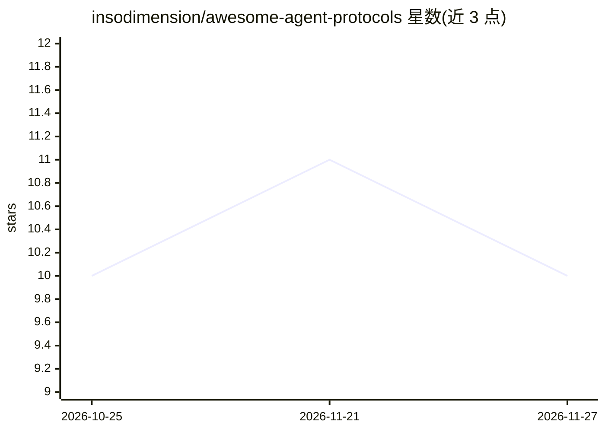

# insodimension/awesome-agent-protocols

⭐ 10 · CC0-1.0 · 推送 2026-09-18 · [GitHub](https://github.com/insodimension/awesome-agent-protocols) · [官网](https://github.com/insodimension/awesome-agent-protocols) · 个人维护

**按栈层级组织的 AI Agent 协议与标准策展清单**

收录 50+ 条 AI Agent 协议与标准，按 Foundations、Tool and context、Agent to agent、Agent to UI、Serving、Identity、Payments、Formats 等栈层级组织；每条含维护方、传输方式（JSON-RPC/SSE/HTTP 402 等）与类别标记，并标注 deprecated 或 merged 状态（如 IBM ACP 并入 A2A）。附 examples/ 目录的线协议消息示例、两篇综述链接，以及一个供开发时检索该目录的 Claude Code skill。适用于需要选择或了解 Agent 互操作协议的开发者。

## 筛选速览

| 维度 | 判定 | 备注 |
|---|---|---|
| AI 角色 | `ai-knowledge` | 知识聚合/清单类 |
| 许可风险 | `viral` | CC0-1.0 |
| 部署形态 | `None` |  |
| 模型依赖 | — | README 未给出锁定关系 |
| 硬件要求 | — | 无带数字的原话,不猜 |
| 安装摩擦 | `low` | 无编译、无系统依赖或容器化 |
| 成熟度 | — | 结构信号不足 |

## 能力要点

- 50+ 条协议按栈层级分类组织（工具上下文、多智能体、UI、支付等）
- 标注协议状态：deprecated/merged（如 IBM ACP 并入 A2A、Sampling 弃用）
- examples/ 目录提供 MCP、A2A、x402 等线消息示例
- 附带 Claude Code skill，开发时推荐协议并检查合规

## 适用场景

- 为 Agent 项目选型工具调用或跨智能体通信协议
- 了解 Agent 支付与身份发现协议的生态现状
- 查阅 MCP、A2A 等协议的线消息格式示例

## 场景标签

`精选清单` · 领域:学习与行业

## 证据(README 行号)

> L3: > A curated list of protocols and standards for AI agents.
> L9: ## Foundations
> L21: - Model Context Protocol (MCP) 🔌 - Anthropic. JSON-RPC 2.0 over stdio or Streamable HTTP. Connects LLM hosts to too

## 星数曲线

2026-10-25 10 → 2026-11-27 10（+0）

---
*卡片 v1 · prompt 1.4 · 生成 2026-11-19 · 置信度 high · 依据 README sha `6ecba08ba993` · [字段定义](../../DATASET.md)*
