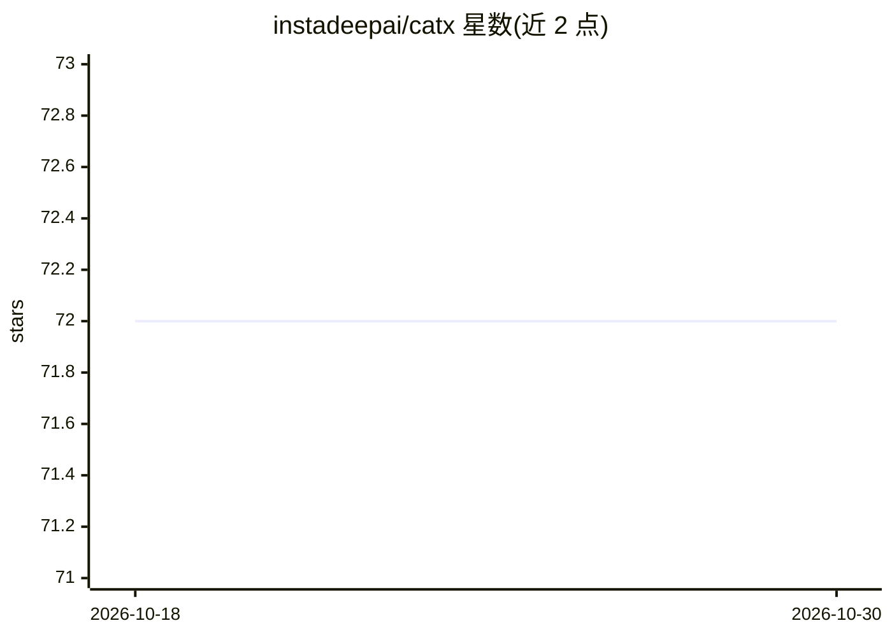

# instadeepai/catx

⭐ 72 · Python · MIT · 推送 2026-07-28 · [GitHub](https://github.com/instadeepai/catx) · [官网](https://catx.readthedocs.io/en/main/) · 组织维护

**JAX 连续动作上下文赌博机训练与决策库**

基于 JAX 实现的上下文赌博机（contextual bandits）库，面向连续动作空间问题：在 CATS 算法（Majzoubi et al.）的树结构中允许接入自定义神经网络架构作为决策代理，用于在连续动作下最大化奖励、处理探索-利用权衡。由 InstaDeep 维护，以 Python 库形式通过 pip 安装，作者为 Wissam Bejjani 与 Cyprien Courtot，2022 年开源发布。

## 筛选速览

| 维度 | 判定 | 备注 |
|---|---|---|
| AI 角色 | `ai-native` | 本体是模型或模型工具 |
| 许可风险 | `permissive` | MIT |
| 部署形态 | `library` | 以包/库形式分发 |
| 模型依赖 | — | README 未给出锁定关系 |
| 硬件要求 | — | 无带数字的原话,不猜 |
| 安装摩擦 | `low` | 无编译、无系统依赖或容器化 |
| 成熟度 | — | 结构信号不足 |

## 能力要点

- 连续动作空间的上下文赌博机训练与使用
- CATS 树结构中支持自定义神经网络决策代理
- 基于 JAX 实现，支持更多上下文模态

## 适用场景

- 需要在连续动作空间做决策并最大化奖励的场景
- 用自定义网络结构实验上下文赌博机算法
- 处理探索-利用权衡的工业决策问题

## 场景标签

`强化学习` · 领域:训练与推理

## 证据(README 行号)

> L3: CATX is a library for training and using contextual bandits in a continuous action space.
> L6: "Efficient Contextual Bandits with Continuous Actions (CATS)" by Majzoubi et al.
> L10: also leveraging the computational speed of JAX.

## 星数曲线

2026-10-18 72 → 2026-10-30 72（+0）

---
*卡片 v1 · prompt 1.4 · 生成 2026-10-24 · 置信度 high · 依据 README sha `7719d6fbc14f` · [字段定义](../../DATASET.md)*
