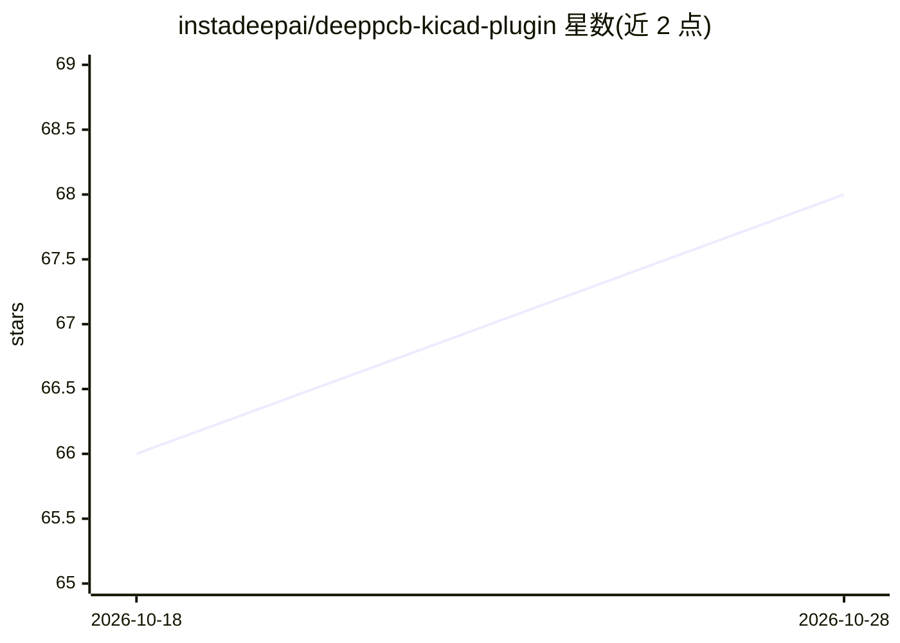

# instadeepai/deeppcb-kicad-plugin

⭐ 69 · Python · Apache-2.0 · 推送 2026-10-08 · [GitHub](https://github.com/instadeepai/deeppcb-kicad-plugin) · [官网](https://deeppcb.ai/) · 组织维护

**为 KiCad 用户提供 DeepPCB 云端 AI 自动布线插件**

KiCad PCB 编辑器的外部插件：将当前 PCB 上传至 DeepPCB 云端布线引擎完成自动布线，完成后下载回 KiCad 项目。需要 DeepPCB 账户与 API key，采用按量积分计费并支持实时余额查询，支持会话恢复中断任务。跨 Windows/macOS/Linux 运行，需 KiCad 6.0 以上（Python 由 KiCad 自带）。可通过 KiCad 插件管理器、zip 文件或手动复制三种方式安装。布线计算依赖云服务，非本地运行。

## 筛选速览

| 维度 | 判定 | 备注 |
|---|---|---|
| AI 角色 | `ai-native` | 本体是模型或模型工具 |
| 许可风险 | `permissive` | Apache-2.0 |
| 部署形态 | `desktop` | 安装包/桌面程序 |
| 模型依赖 | — | README 未给出锁定关系 |
| 硬件要求 | — | 无带数字的原话,不猜 |
| 安装摩擦 | `low` | 无编译、无系统依赖或容器化 |
| 成熟度 | — | 结构信号不足 |

## 能力要点

- DeepPCB 云端引擎驱动的 AI 自动布线
- 积分计费与实时余额跟踪
- 会话恢复：中断的布线任务可继续
- 支持 Windows/macOS/Linux 三平台

## 适用场景

- 在 KiCad 中一键将 PCB 交给云端自动布线
- 布线中断后恢复任务继续等待结果
- 查看布线积分余额并按用量付费

## 场景标签

 · 领域:EDA/PCB 设计工具

## 证据(README 行号)

> L3: AI-powered PCB routing plugin for KiCad. Route your board automatically using the DeepPCB cloud engine — directly fr
> L9: - **AI-powered routing** — Automatic PCB routing driven by DeepPCB's cloud engine

## 星数曲线

2026-10-18 66 → 2026-10-28 68（+2）

---
*卡片 v1 · prompt 1.4 · 生成 2026-10-24 · 置信度 high · 依据 README sha `f8dcf9a64d04` · [字段定义](../../DATASET.md)*
