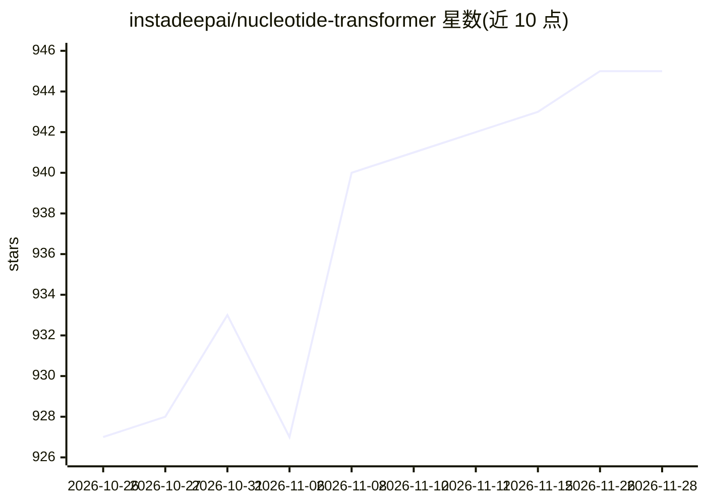

# instadeepai/nucleotide-transformer

⭐ 945 · Jupyter Notebook · NOASSERTION · 推送 2026-11-02 · [GitHub](https://github.com/instadeepai/nucleotide-transformer) · 组织维护

**面向基因组学研究者的 DNA/转录组基础模型集合与推理代码**

InstaDeep 维护的基因组语言模型仓库，收录 Nucleotide Transformer 系列（NT/NTv2/NTv3）、AgroNT、SegmentNT、ChatNT、Isoformer、sCT、BulkRNABert、MOJO 等模型，提供推理代码、预训练权重（Hugging Face）、微调 Notebook 与论文链接。NTv3 支持最长 1 Mb 上下文的功能轨迹预测、基因组注释（FASTA→GFF3）与可控序列生成，并提供在 Claude Code 中运行的位点分析技能。以 Python 包形式安装，基于 JAX，GPU 路径需 pip extra。许可证为 CC BY-NC-SA 4.0（非商业）。

## 筛选速览

| 维度 | 判定 | 备注 |
|---|---|---|
| AI 角色 | `ai-native` | 本体是模型或模型工具 |
| 许可风险 | `none` | NOASSERTION |
| 部署形态 | `library` | 以包/库形式分发 |
| 模型依赖 | — | README 未给出锁定关系 |
| 硬件要求 | — | 无带数字的原话,不猜 |
| 安装摩擦 | `low` | 无编译、无系统依赖或容器化 |
| 成熟度 | — | 结构信号不足 |

## 能力要点

- NTv3 支持 1 Mb 上下文、单碱基分辨率的功能轨迹预测与基因组注释
- 提供 FASTA→GFF3 端到端注释命令 ntv3-annotate
- 模型权重发布于 Hugging Face，附 LoRA 与常规微调 Notebook
- NTv3 位点分析技能可在 Claude Code 中按自然语言请求运行

## 适用场景

- 对基因组序列做功能轨迹预测与注释
- 提取 DNA/RNA 序列嵌入用于下游预测任务
- 在 Claude Code 中用一句话请求某个基因位点的预测与报告

## 场景标签

`微调` · 领域:训练与推理

## 证据(README 行号)

> L19: Welcome to the InstaDeep AI for Genomics repository! This is where we feature our collection of transformer-based g
> L21: Our mission is to provide the scientific community with powerful, reproducible, and accessible tools to unlock new 
> L31: A unified multi-species foundation model that brings representation learning, functional-track prediction, genome a

## 星数曲线

2026-10-26 927 → 2026-11-28 945（+18）

---
*卡片 v1 · prompt 1.4 · 生成 2026-11-24 · 置信度 high · 依据 README sha `31be1a3e3191` · [字段定义](../../DATASET.md)*
