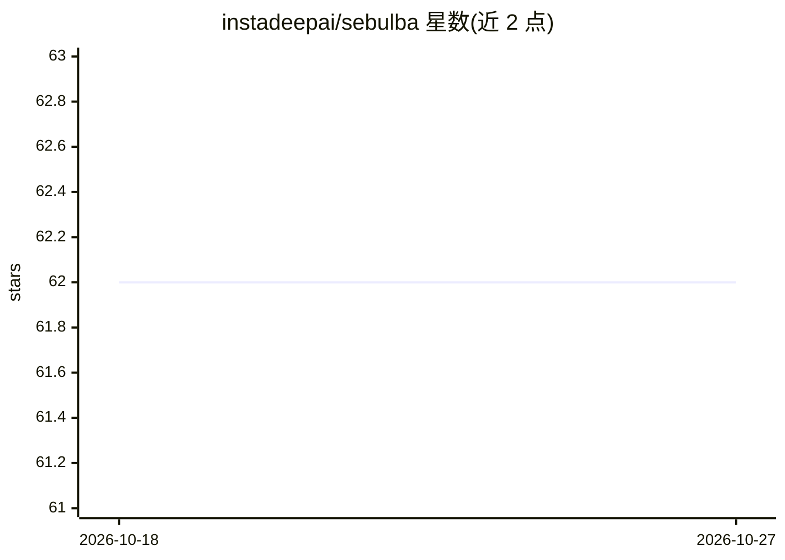

# instadeepai/sebulba

⭐ 62 · Python · Apache-2.0 · 推送 2026-08-22 · [GitHub](https://github.com/instadeepai/sebulba) · 组织维护

**面向科研者的 JAX 分布式强化学习架构 Sebulba 的实现**

InstaDeep 对 Google DeepMind Podracer 论文提出的 Sebulba 分布式 RL 架构的实现：采用 Actor-Learner 分解，将环境放在 CPU、推理与学习分布在同一 TPU 机器的核心上，默认实现 PPO 算法且可替换为其他 RL 算法。面向希望扩展自有 RL agent 的研究人员，需 fork 仓库后用脚本与 Makefile 运行实验。提供容器化部署路径（本地 CPU 伪造多设备、单机 A100 GPU、GCP TPU VM），README 含多硬件吞吐与收敛基准。需要 Python 3.9。

## 筛选速览

| 维度 | 判定 | 备注 |
|---|---|---|
| AI 角色 | `ai-native` | 本体是模型或模型工具 |
| 许可风险 | `permissive` | Apache-2.0 |
| 部署形态 | `None` |  |
| 模型依赖 | — | README 未给出锁定关系 |
| 硬件要求 | — | 无带数字的原话,不猜 |
| 安装摩擦 | `low` | 无编译、无系统依赖或容器化 |
| 成熟度 | — | 结构信号不足 |

## 能力要点

- Actor-Learner 分解，acting 与 learning 共置于单台 TPU 机器
- 默认 PPO 实现，支持替换为其他 RL 算法与任意环境
- 容器化部署，覆盖本地 CPU、A100 GPU 与 GCP TPU VM
- 提供 TPU 核心 8-128 扩展的收敛与吞吐基准

## 适用场景

- 在 TPU 上扩展运行 PPO 等 RL 算法实验
- 在单机上伪造多 XLA 设备做本地测试
- 作为起点改写以扩展自己的 RL agent

## 场景标签

`强化学习` · 领域:训练与推理

## 证据(README 行号)

> L28: We provide an implementation of Sebulba, introduced in Google DeepMind's Podracer paper.
> L31: implementation of Sebulba uses the PPO algorithm, but Sebulba can be augmented to use many popular

## 星数曲线

2026-10-18 62 → 2026-10-27 62（+0）

---
*卡片 v1 · prompt 1.4 · 生成 2026-10-24 · 置信度 high · 依据 README sha `044083fb0331` · [字段定义](../../DATASET.md)*
