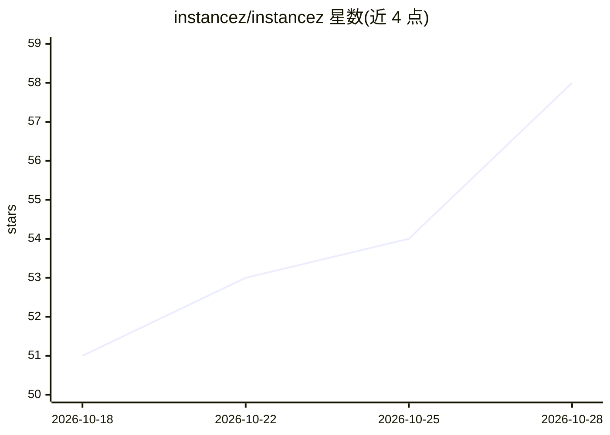

# instancez/instancez

⭐ 58 · Go · Apache-2.0 · 推送 2026-10-27 · [GitHub](https://github.com/instancez/instancez) · [官网](https://instancez.ai) · 组织维护

**给开发者的单二进制 Supabase 替代后端：YAML 定义全栈**

用 Go 编写的自托管后端平台，以单个 YAML 文件声明表、RLS、存储、RPC 与函数，通过 diff 对比活库应用增量变更，兼容 supabase-js 客户端（auth、PostgREST 风格 REST、RPC、存储）。提供嵌入式 Postgres 的本地开发命令、内置 dashboard、可部署到 Docker/Kubernetes/Lambda 或 instancez Cloud。面向 LLM 编程代理设计可端到端阅读的 schema，并附带教代理 YAML 语法与 CLI 的技能文件。实时 websockets 尚不支持，OAuth 内置 Google/GitHub/Apple。

## 筛选速览

| 维度 | 判定 | 备注 |
|---|---|---|
| AI 角色 | `ai-ecosystem` | LLM/agent 周边工具 |
| 许可风险 | `permissive` | Apache-2.0 |
| 部署形态 | `self-host` | docker 或自建部署 |
| 模型依赖 | — | README 未给出锁定关系 |
| 硬件要求 | — | 无带数字的原话,不猜 |
| 安装摩擦 | `low` | 无编译、无系统依赖或容器化 |
| 成熟度 | — | 结构信号不足 |

## 能力要点

- 单一 YAML 文件声明 schema，自动 diff 应用增量迁移
- 兼容 @supabase/supabase-js 客户端与 PostgREST 风格 REST API
- 单二进制运行，支持 Docker/Kubernetes/AWS Lambda 自托管
- 附带支持 Claude Code/Codex/Cursor 等代理的 SKILL.md 技能文件

## 适用场景

- 用 supabase-js 的应用切换到自托管单二进制后端
- 让 LLM 编程代理通过单一 YAML 理解并修改后端 schema
- 本地一键启动带 auth/RLS/存储的全栈后端原型

## 场景标签

 · 领域:后端/数据库基础设施

## 证据(README 行号)

> L5: **An LLM-friendly, single-binary, drop-in replacement to Supabase.**
> L20: - **LLM-friendly.** A simple, easy-to-understand YAML schema — tables, RLS, storage, RPC, functions — one file an L
> L88: The repo ships an agent skill that teaches your coding agent the YAML syntax, RLS patterns, and the `inz` CLI. Inst

## 星数曲线

2026-10-18 51 → 2026-10-28 58（+7）

---
*卡片 v1 · prompt 1.4 · 生成 2026-10-24 · 置信度 mid · 依据 README sha `7f98b3a523d0` · [字段定义](../../DATASET.md)*
