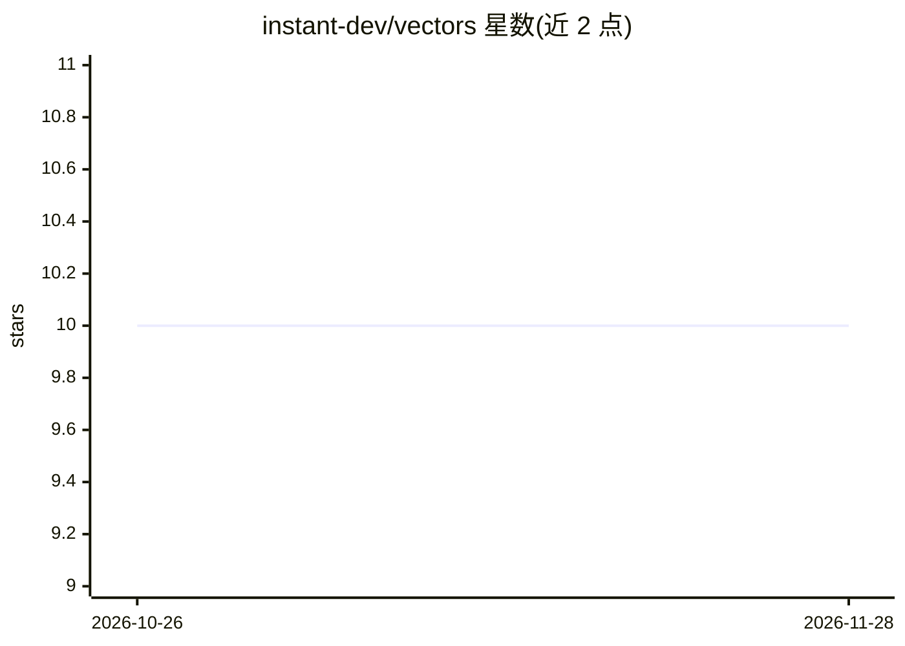

# instant-dev/vectors

⭐ 10 · JavaScript · 推送 2026-03-12 · [GitHub](https://github.com/instant-dev/vectors) · 个人维护

**OpenAI 向量批量生成的 Node 工具库**

面向 Node.js 服务端的向量批量创建工具：调用 OpenAI embeddings API 时，通过 VectorManager 在可配置时间窗（默认 100ms）内聚合多条向量创建请求并自动分批，规避并行请求被限流的 IO 性能问题。适用于 Web 服务器中多个用户请求同时生成向量的场景，共享同一实例即可统一分批。需自行提供 OpenAI API key，单请求受 8,191 token 上限约束。

## 筛选速览

| 维度 | 判定 | 备注 |
|---|---|---|
| AI 角色 | `ai-ecosystem` | LLM/agent 周边工具 |
| 许可风险 | `none` | — |
| 部署形态 | `library` | 以包/库形式分发 |
| 模型依赖 | — | README 未给出锁定关系 |
| 硬件要求 | — | 无带数字的原话,不猜 |
| 安装摩擦 | `low` | 无编译、无系统依赖或容器化 |
| 成熟度 | — | 结构信号不足 |

## 能力要点

- 自动收集 100ms 时间窗内的请求并分批调用 embeddings API
- 提供 create 与 batchCreate 两种向量创建方式
- 分批引擎可自定义（setEngine）以适配不同 embedding 来源

## 适用场景

- 服务端批量索引文档向量时避免 API 限流
- 多用户请求并发创建向量的 Web 服务场景

## 场景标签

 · 领域:LLM 基础设施/向量管理

## 证据(README 行号)

> L14: **Solution:** `@instant.dev/vectors` provides a simple `VectorManager` utility that performs
> L19: It is most useful in web server contexts where multiple user requests may be
> L59: Vectors.setEngine(async (values) => {

## 星数曲线

2026-10-26 10 → 2026-11-28 10（+0）

---
*卡片 v1 · prompt 1.4 · 生成 2026-11-19 · 置信度 high · 依据 README sha `078873931fa4` · [字段定义](../../DATASET.md)*
