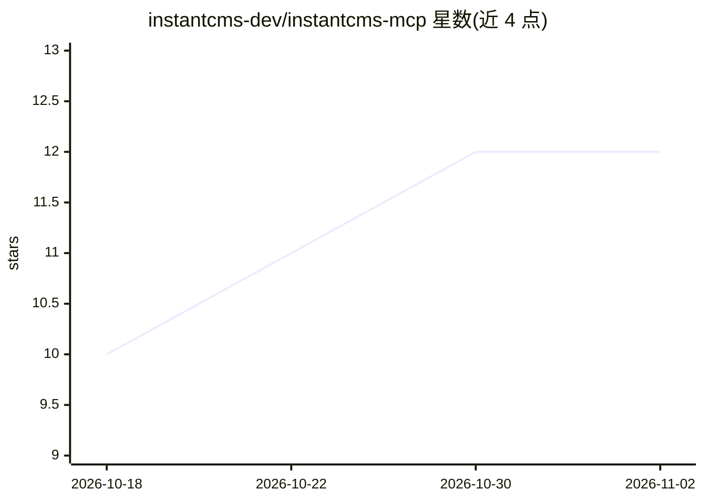

# instantcms-dev/instantcms-mcp

⭐ 12 · TypeScript · MIT · 推送 2026-10-19 · [GitHub](https://github.com/instantcms-dev/instantcms-mcp) · [官网](https://www.npmjs.com/package/@maxisoft/instantcms-mcp) · 组织维护

**InstantCMS 2 开发用 MCP 服务器：101 个工具与源码校验的 API 知识库**

面向 InstantCMS 2 扩展/组件/模板开发的 MCP server：提供钩子与核心类参考资料（数据与上游源码 commit 同步、provenance 测试校验）、五类扩展生成器、包路径校验、诊断工具与 maria_* 数据库工具（默认只读、敏感列脱敏）。生成器在真实 InstantCMS 实例上以 CI 场景验证；支持 stdio 与可选 Streamable HTTP（Bearer 令牌、限流、会话）、工具分组禁用以降低 token 消耗。经 npm、GitHub Release ZIP、源码或 GHCR Docker 镜像安装，需 Node.js ≥22。

## 筛选速览

| 维度 | 判定 | 备注 |
|---|---|---|
| AI 角色 | `ai-ecosystem` | LLM/agent 周边工具 |
| 许可风险 | `permissive` | MIT |
| 部署形态 | `desktop` | 安装包/桌面程序 |
| 模型依赖 | — | README 未给出锁定关系 |
| 硬件要求 | — | 无带数字的原话,不猜 |
| 安装摩擦 | `low` | 无编译、无系统依赖或容器化 |
| 成熟度 | — | 结构信号不足 |

## 能力要点

- 101 个 MCP 工具与 4 个内置 MCP resource
- 知识库与 instantsoft/icms2 固定 commit 同步并由 provenance 测试校验可信级别
- 五类扩展生成器经 `npm run verify:generated` 在真实 InstantCMS 上运行时验证
- 可选 Streamable HTTP 传输（Bearer 鉴权、IP 限流、会话模式）与工具分组禁用

## 适用场景

- 通过 Claude Code、Cursor 等 MCP 客户端开发 InstantCMS 扩展与模板
- 查询有源码出处的 InstantCMS 钩子与核心类参考
- 在受只读与脱敏约束下排查 InstantCMS 站点的 MariaDB 数据
- 以 Docker 部署供远程客户端接入的 InstantCMS 开发助手服务

## 场景标签

`代码生成` · 领域:编码与开发

## 证据(README 行号)

> L8: MCP-сервер и набор переносимых AI-workflows для разработки дополнений, виджетов, шаблонов и layout-схем InstantCMS 2
> L43: - 101 MCP-инструментов и четыре встроенных MCP resource;

## 星数曲线

2026-10-18 10 → 2026-11-02 12（+2）

---
*卡片 v1 · prompt 1.4 · 生成 2026-11-01 · 置信度 high · 依据 README sha `a52100fc350c` · [字段定义](../../DATASET.md)*
