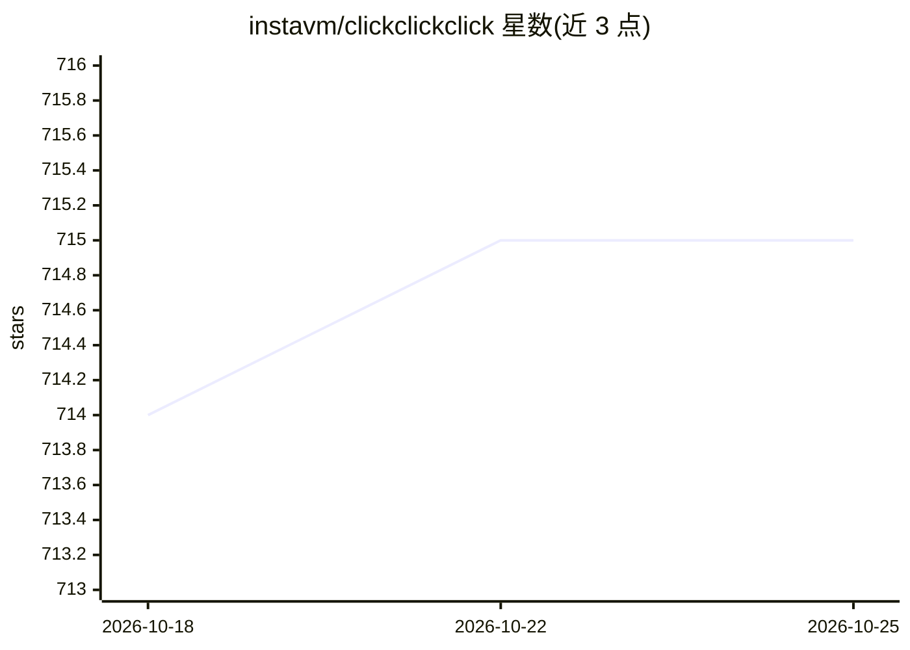

# instavm/clickclickclick

⭐ 715 · Python · MIT · 推送 2026-03-17 · [GitHub](https://github.com/instavm/clickclickclick) · [官网](https://instavm.io) · 组织维护

**用任意 LLM 驱动 Android 与计算机自主操作的开源框架**

一个自主设备操作框架：由 Planner（任务规划）、Finder（UI 元素定位）、Executor（执行）三个组件构成，将自然语言任务转化为对 Android（经 adb）或 macOS 平台的实际操作。模型侧支持 OpenAI、Gemini 及经 Ollama 运行的本地模型（如 Llama 3.2-vision、qwen3.5:4b），planner 与 finder 可分别选用不同模型，并提供 --image-quality 参数调整截图尺寸以加速处理。提供 CLI 与 FastAPI HTTP API（POST /execute）两种使用方式。作者声明代码处于高度实验阶段。

## 筛选速览

| 维度 | 判定 | 备注 |
|---|---|---|
| AI 角色 | `ai-ecosystem` | LLM/agent 周边工具 |
| 许可风险 | `permissive` | MIT |
| 部署形态 | `library` | 以包/库形式分发 |
| 模型依赖 | local-ok | 支持本地模型 |
| 硬件要求 | — | 无带数字的原话,不猜 |
| 安装摩擦 | `low` | 无编译、无系统依赖或容器化 |
| 成熟度 | `idea` | |

## 能力要点

- Planner/Finder/Executor 三组件架构，两类模型可分别配置
- 支持 Android 与 macOS 平台的自主任务执行
- 支持 Ollama 本地模型作为 planner/finder 后端
- 提供 CLI 与 HTTP API 两种调用方式

## 适用场景

- 用自然语言指令自动操作 Android 应用完成事务
- 通过 API 将 LLM 驱动的设备操作集成到自动化流程
- 用本地 Ollama 模型跑设备操作任务避免外发数据

## 场景标签

`GUI 自动化` · 领域:效率与自动化

## 证据(README 行号)

> L3: ### A framework to enable autonomous android and computer use using any LLM (local or remote)
> L18: Currently supporting local models via Ollama (Llama 3.2-vision, qwen3.5:4b), Gemini, GPT 4o. The current code is hi
> L90: - `--platform`: Specifies the platform to use, either `android` or `osx`. Default is `android`.

## 星数曲线

2026-10-18 714 → 2026-10-25 715（+1）

---
*卡片 v1 · prompt 1.4 · 生成 2026-10-21 · 置信度 high · 依据 README sha `846c135b7bb3` · [字段定义](../../DATASET.md)*
