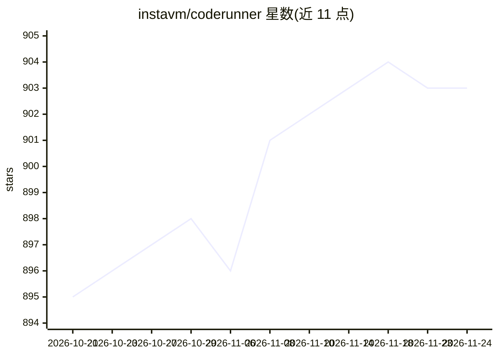

# instavm/coderunner

⭐ 903 · Python · Apache-2.0 · 推送 2026-11-22 · [GitHub](https://github.com/instavm/coderunner) · [官网](https://instavm.io) · 组织维护

**给 AI agent 的本地沙箱：隔离执行其代码与操作**

基于 Apple container 的本地沙箱工具，将 AI agent 生成的代码放入 VM 级隔离容器中执行，可配置 CPU/内存限制、/workspace 主机目录挂载（默认只读）与 outbound 网络开关。通过内置 MCP server（端口 8222）向 Claude Code、Claude Desktop、OpenCode、OpenAI Agents、Gemini CLI、Kiro 等客户端暴露 execute_python_code、命名会话隔离内核、Playwright 抓取及技能系统（PDF/图像处理，可自定义 SKILL.md）。要求 Mac + Apple Silicon + Python 3.10+，提供 InstaVM 云端托管方案。

## 筛选速览

| 维度 | 判定 | 备注 |
|---|---|---|
| AI 角色 | `ai-ecosystem` | LLM/agent 周边工具 |
| 许可风险 | `permissive` | Apache-2.0 |
| 部署形态 | `library` | 以包/库形式分发 |
| 模型依赖 | — | README 未给出锁定关系 |
| 硬件要求 | — | 无带数字的原话,不猜 |
| 安装摩擦 | `low` | 无编译、无系统依赖或容器化 |
| 成熟度 | — | 结构信号不足 |

## 能力要点

- VM 级隔离容器，支持 CPU/内存限制与只读/读写挂载控制
- 内置 MCP server，兼容 Claude Code/Desktop、OpenCode、Gemini CLI、Kiro 等客户端
- 命名会话隔离的持久 Jupyter 内核，最多 5 个并发会话
- 可扩展技能系统（SKILL.md + scripts），含 PDF 表单替换等内置技能

## 适用场景

- 让 AI agent 写的代码在隔离沙箱中执行，不直接碰主机
- 处理不可信输入的代码或多个互不共享状态的 agent 并行运行
- 限制 agent 的网络与文件访问范围

## 场景标签

 · 领域:开发工具/agent 基础设施

## 证据(README 行号)

> L6: CodeRunner helps you sandbox your AI agents and its actions inside a sandbox.
> L101: MCP server will be available at: `http://coderunner.local:8222/mcp`
> L331: - **Sandbox Container:** Isolated execution environment with Jupyter kernel

## 星数曲线

2026-10-21 895 → 2026-11-24 903（+8）

---
*卡片 v1 · prompt 1.4 · 生成 2026-11-24 · 置信度 mid · 依据 README sha `a46bd61c5ea9` · [字段定义](../../DATASET.md)*
