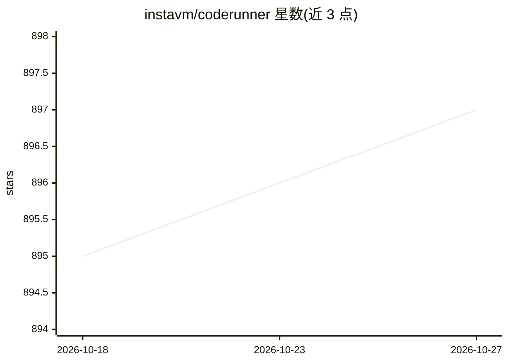

# instavm/coderunner

⭐ 897 · Python · Apache-2.0 · 推送 2026-10-10 · [GitHub](https://github.com/instavm/coderunner) · [官网](https://instavm.io) · 组织维护

**给 AI agent 用的本地隔离沙箱：在容器中安全执行代码**

基于 Apple container 的 macOS 本地沙箱，为 Claude Code、Claude Desktop、OpenCode、OpenAI Agents、Gemini-CLI、Kiro 等 AI agent 提供隔离的代码执行环境：沙箱容器内含持久化 Jupyter 内核，通过 MCP Server（端口 8222）与模型通信，支持最多 5 个并发命名会话、Web 抓取（Playwright）及可扩展的 Skills 系统（PDF 处理、图像裁剪等）。容器具备 VM 级隔离，可停止/恢复并可禁用出站网络。限定 Apple Silicon Mac（M1-M4）与 Python 3.10+。

## 筛选速览

| 维度 | 判定 | 备注 |
|---|---|---|
| AI 角色 | `ai-ecosystem` | LLM/agent 周边工具 |
| 许可风险 | `permissive` | Apache-2.0 |
| 部署形态 | `library` | 以包/库形式分发 |
| 模型依赖 | — | README 未给出锁定关系 |
| 硬件要求 | — | 无带数字的原话,不猜 |
| 安装摩擦 | `low` | 无编译、无系统依赖或容器化 |
| 成熟度 | — | 结构信号不足 |

## 能力要点

- Apple container 实现的 VM 级隔离沙箱，支持停止/恢复并保留状态
- 通过 MCP Server 向各类 AI agent 提供代码执行、会话管理、网页抓取工具
- 内置 Skills 系统，支持用户自定义技能（SKILL.md + 脚本）
- 可设置 host-only 网络禁用出站访问

## 适用场景

- 让 Claude Code 或其他 agent 在隔离环境中执行代码，避免数据丢失与外泄
- 多 agent 并发运行，各自使用隔离的 Python 内核会话
- 在断网沙箱中运行不可信的 AI 生成代码

## 场景标签

`网页抓取` · 领域:效率与自动化

## 证据(README 行号)

> L6: CodeRunner helps you sandbox your AI agents and its actions inside a sandbox.
> L288: - **MCP Server:** Handles communication between AI models and the sandbox
> L287: - **Sandbox Container:** Isolated execution environment with Jupyter kernel

## 星数曲线

2026-10-18 895 → 2026-10-27 897（+2）

---
*卡片 v1 · prompt 1.4 · 生成 2026-10-21 · 置信度 mid · 依据 README sha `3512be18f7c5` · [字段定义](../../DATASET.md)*
