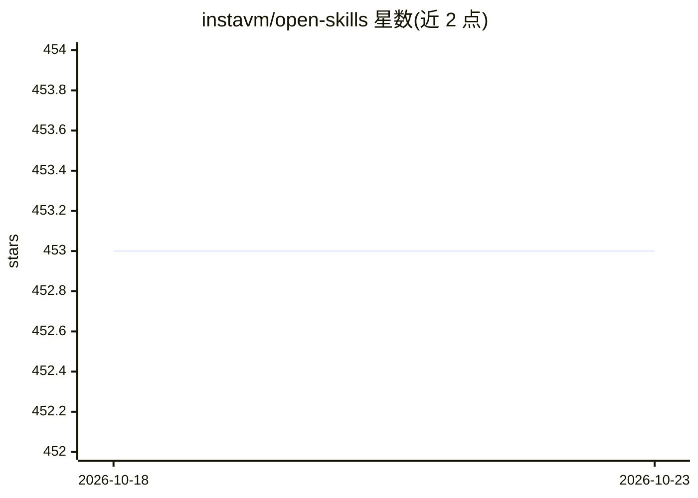

# instavm/open-skills

⭐ 453 · Python · Apache-2.0 · 推送 2026-01-23 · [GitHub](https://github.com/instavm/open-skills) · 组织维护

**在 Mac 本地沙箱中运行 Claude Skills 的 MCP 服务器**

面向 Mac（Apple Silicon）用户的 MCP 服务器：将 Anthropic Claude Skills 格式的技能（含官方技能与自定义技能，以 SKILL.md 为必备文件）在本地 Apple 原生容器的沙箱中执行，通过路径映射兼容 Claude 技能的 /mnt/user-data 路径，无需修改即可运行。提供 execute_python_code、list_skills、get_skill_info 等 MCP 工具，支持接入 Claude Desktop、Gemini CLI、Qwen CLI、OpenCode、OpenAI Python agents 等任意 MCP 兼容客户端。文件处理全程本地，不上传云端。限制：仅支持 macOS Apple Silicon（M1-M5）与 Python 3.10+。

## 筛选速览

| 维度 | 判定 | 备注 |
|---|---|---|
| AI 角色 | `ai-ecosystem` | LLM/agent 周边工具 |
| 许可风险 | `permissive` | Apache-2.0 |
| 部署形态 | `library` | 以包/库形式分发 |
| 模型依赖 | — | README 未给出锁定关系 |
| 硬件要求 | — | 无带数字的原话,不猜 |
| 安装摩擦 | `low` | 无编译、无系统依赖或容器化 |
| 成熟度 | — | 结构信号不足 |

## 能力要点

- Claude Skills 无需修改即在本地沙箱运行（路径映射 /mnt/user-data → /app/uploads）
- Apple 原生容器提供 VM 级隔离的代码执行环境（含 Jupyter kernel）
- 暴露 5 个 MCP 工具：代码执行、技能列表/读取/文档、Playwright 网页抓取
- 支持导入 Anthropic 官方技能或自建 SKILL.md 技能

## 适用场景

- 让本地 AI 客户端处理 PDF、表格、图片等敏感文件而不上传云端
- 在 Claude Desktop / Gemini CLI / Qwen CLI 中调用 Claude Skills 处理文档任务
- 为自己的工作流编写并运行自定义技能

## 场景标签

`网页抓取` `Agent 框架` · 领域:Agent 开发

## 证据(README 行号)

> L15: Anthropic recently announced Skills for Claude - reusable folders with instructions, scripts, and resources that ma
> L31: - **Compatibility:** Works with Claude Desktop, Gemini CLI, Qwen CLI, or any MCP-compatible tool
> L253: - **MCP Server:** Handles communication between AI models and the sandbox

## 星数曲线

2026-10-18 453 → 2026-10-23 453（+0）

---
*卡片 v1 · prompt 1.4 · 生成 2026-10-21 · 置信度 mid · 依据 README sha `51ddce7b9e8e` · [字段定义](../../DATASET.md)*
