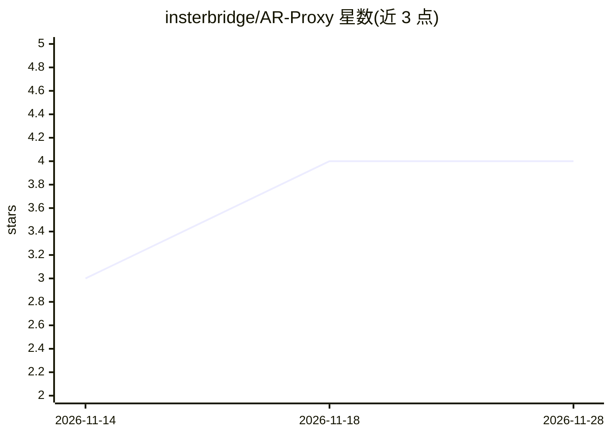

# insterbridge/AR-Proxy

⭐ 4 · TypeScript · MIT · 推送 2026-11-17 · [GitHub](https://github.com/insterbridge/AR-Proxy) · 个人维护

**本地自动重试代理，为 AgentRouter 上游失败做重试与并发限制**

运行于 127.0.0.1:15720 的本地 HTTP 转发代理：读取响应状态与响应体识别上游限流（包括 SSE 响应内的限流错误），自动重试，并限制大请求并发。自身不做 API 格式转换，上游为 AgentRouter 或本地桥接（cc-switch）；另提供 Claude Code 启动器，自动起代理并以临时 settings 文件注入 base URL。需 Bun 运行时，无构建步骤与包安装。

## 筛选速览

| 维度 | 判定 | 备注 |
|---|---|---|
| AI 角色 | `ai-ecosystem` | LLM/agent 周边工具 |
| 许可风险 | `permissive` | MIT |
| 部署形态 | `None` |  |
| 模型依赖 | — | README 未给出锁定关系 |
| 硬件要求 | — | 无带数字的原话,不猜 |
| 安装摩擦 | `low` | 无编译、无系统依赖或容器化 |
| 成熟度 | — | 结构信号不足 |

## 能力要点

- 依据状态码与响应体识别限流并自动重试（含 SSE 内嵌错误）
- 大上下文请求并发门控（默认 60000 tokens、并发 1）
- Claude Code 启动器：临时 settings 覆写 ANTHROPIC_BASE_URL，不改原配置
- 同源重定向重写回代理，异源重定向以 502 拒绝

## 适用场景

- 上游把限流写进响应体导致客户端不会重试的场景
- Claude Code 通过本地代理访问 AgentRouter 并获得自动重试
- 限制并发大请求避免上游过载

## 场景标签

`模型网关` · 领域:Agent 开发

## 证据(README 行号)

> L3: A small local proxy that retries selected AgentRouter failures and limits how
> L12: AR-Proxy forwards HTTP requests; it does not translate between the Anthropic
> L166: The proxy can run on its own. If you use Claude Code, `claude.ts` also handles

## 星数曲线

2026-11-14 3 → 2026-11-28 4（+1）

---
*卡片 v1 · prompt 1.4 · 生成 2026-11-21 · 置信度 high · 依据 README sha `a4b1aaed03ac` · [字段定义](../../DATASET.md)*
