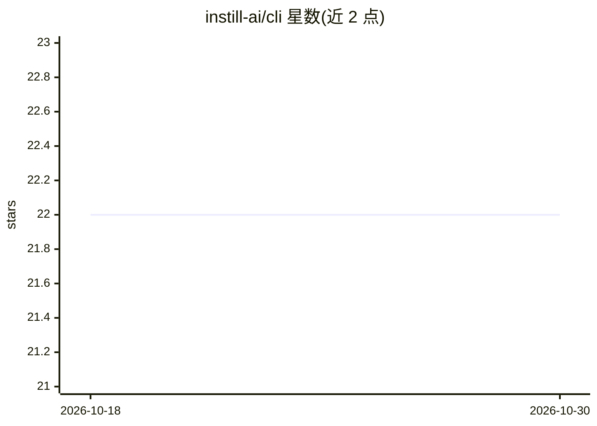

# instill-ai/cli

⭐ 22 · Go · MIT · 推送 2025-12-02 · [GitHub](https://github.com/instill-ai/cli) · [官网](https://www.instill-ai.com) · 组织维护

**Instill Core 平台的官方命令行工具 inst**

inst 是 instill-ai 为 Instill Core（面向非结构化数据的 AI/ETL 数据流水线平台）提供的命令行工具，通过命令操作 Core 的资源与流水线。支持 macOS 与 Linux，不支持 Windows。安装途径为 Homebrew 或从 releases 页面下载二进制文件。API 以 gRPC protobuf 定义，文档可在本地 make all 后访问或通过 make doc 生成。

## 筛选速览

| 维度 | 判定 | 备注 |
|---|---|---|
| AI 角色 | `ai-ecosystem` | LLM/agent 周边工具 |
| 许可风险 | `permissive` | MIT |
| 部署形态 | `desktop` | 安装包/桌面程序 |
| 模型依赖 | — | README 未给出锁定关系 |
| 硬件要求 | — | 无带数字的原话,不猜 |
| 安装摩擦 | `low` | 无编译、无系统依赖或容器化 |
| 成熟度 | — | 结构信号不足 |

## 能力要点

- 操作 Instill Core 的命令行入口，提供 help 等命令
- 支持 macOS/Linux，暂不支持 Windows
- 通过 Homebrew 安装或下载二进制发布包
- API 以 gRPC protobuf 为唯一事实来源

## 适用场景

- 在终端中管理 Instill Core 的流水线与资源
- 脚本化操作 Instill Core 实例

## 场景标签

 · 领域:AI 数据流水线/开发者工具

## 证据(README 行号)

> L7: `inst` is a command line tool for **Instill Core.
> L52: The gRPC protocols in protobufs provide the single source of truth for the VDP APIs. The genuine protobuf documenta

## 星数曲线

2026-10-18 22 → 2026-10-30 22（+0）

---
*卡片 v1 · prompt 1.4 · 生成 2026-10-27 · 置信度 mid · 依据 README sha `92bd29a077e3` · [字段定义](../../DATASET.md)*
