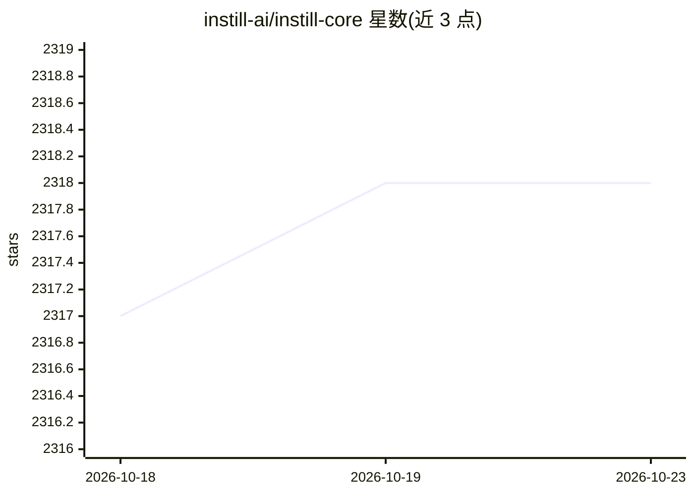

# instill-ai/instill-core

⭐ 2,318 · Python · NOASSERTION · 推送 2026-06-01 · [GitHub](https://github.com/instill-ai/instill-core) · [官网](https://www.instill-ai.com) · 组织维护

**端到端 AI 平台：数据、模型与流水线编排一体化**

Instill Core 是面向构建 AI 应用的全栈基础设施平台，覆盖四类核心功能：Pipeline（构建 AI-first API 与自动化工作流）、Component（连接构件组建流水线）、Artifact（将文档/图像/音频/视频等非结构化数据转为 AI-ready 格式）、Model（部署与监控 AI 模型）。支持将 PDF 解析为 Markdown、LLM 结构化输出、网页抓取、实例分割等场景。通过 git clone 后 make run 拉起全套 Docker 服务，提供 Console、CLI 与 Python/TypeScript SDK 访问；需 Docker Engine v25+ 与 Compose v2+，Windows 需 WSL2。

## 筛选速览

| 维度 | 判定 | 备注 |
|---|---|---|
| AI 角色 | `ai-ecosystem` | LLM/agent 周边工具 |
| 许可风险 | `none` | NOASSERTION |
| 部署形态 | `self-host` | docker 或自建部署 |
| 模型依赖 | — | README 未给出锁定关系 |
| 硬件要求 | — | 无带数字的原话,不猜 |
| 安装摩擦 | `low` | 无编译、无系统依赖或容器化 |
| 成熟度 | — | 结构信号不足 |

## 能力要点

- 非结构化数据 ETL 处理与 AI-ready 转换（文档/图像/音频/视频）
- 低代码/无代码流水线编排构建 AI API 与自动化工作流
- 开源 LLM 托管与 RAG 能力
- 提供 Console、CLI、Python/TypeScript SDK 多种客户端

## 适用场景

- 搭建本地数据 ETL + 模型 + 流水线一体的 AI 基础设施
- 将 PDF 等非结构化数据转为 AI 可用格式并构建 RAG 应用
- 通过低代码流水线快速生成 AI API 与自动化工作流

## 场景标签

`工作流自动化` `RAG` `文档解析` · 领域:效率与自动化

## 证据(README 行号)

> L16: **Instill Core** is an end-to-end AI platform for data, pipeline and model orchestration.
> L22: - 💧 **Pipeline**: Quickly build versatile AI-first APIs or automated workflows.

## 星数曲线

2026-10-18 2,317 → 2026-10-23 2,318（+1）

---
*卡片 v1 · prompt 1.4 · 生成 2026-10-21 · 置信度 high · 依据 README sha `d5eac50d4346` · [字段定义](../../DATASET.md)*
