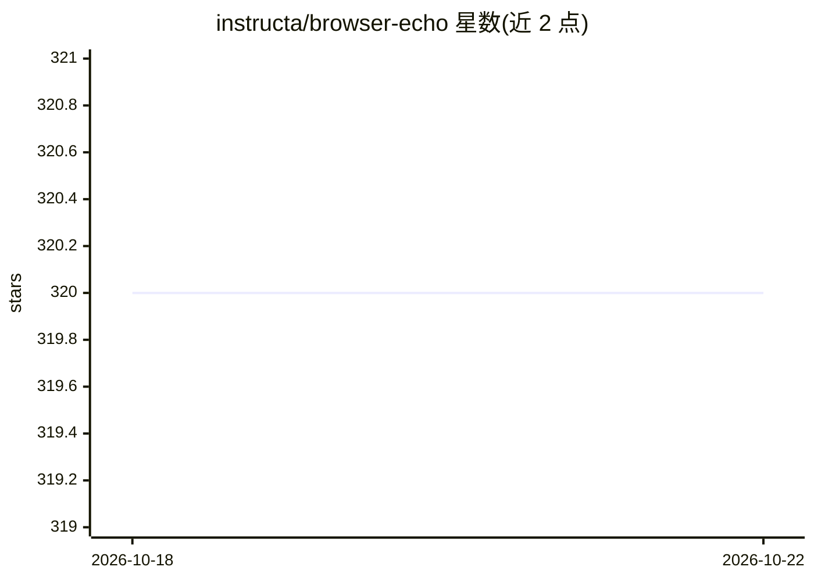

# instructa/browser-echo

⭐ 320 · TypeScript · MIT · 推送 2026-08-07 · [GitHub](https://github.com/instructa/browser-echo) · 个人维护

**把浏览器控制台日志流式传到终端，供 AI 编码助手读取**

面向开发阶段的日志桥接工具：通过注入客户端补丁包装 console.log/info/warn/error/debug，将浏览器端日志批量转发到开发服务器终端，附带来源提示（file:line:col）与堆栈，支持彩色输出、可选文件日志与可选网络请求捕获（fetch/XHR/WebSocket）。提供 MCP server 供 AI 编码助手集成，README 也说明多数场景终端输出已足够、MCP 非必需。支持 React/Vue/Nuxt/Next.js/TanStack Start/Vite 等框架，仅在开发环境生效，不注入生产构建。

## 筛选速览

| 维度 | 判定 | 备注 |
|---|---|---|
| AI 角色 | `ai-ecosystem` | LLM/agent 周边工具 |
| 许可风险 | `permissive` | MIT |
| 部署形态 | `None` |  |
| 模型依赖 | locked-api |  |
| 硬件要求 | — | 无带数字的原话,不猜 |
| 安装摩擦 | `low` | 无编译、无系统依赖或容器化 |
| 成熟度 | — | 结构信号不足 |

## 能力要点

- 包装 console.* 并批量转发浏览器日志到开发终端
- 提供 MCP server 供 AI 编码助手读取日志
- 支持 React/Vue/Nuxt 3/4/Next.js/TanStack Start/Vite 等框架
- 可选网络捕获（fetch/XHR/WebSocket）与文件日志（仅 Vite）

## 适用场景

- 让 Cursor/Claude Code 等 AI 编码助手直接读到浏览器端日志
- 开发时在终端查看前端 console 输出与堆栈
- 多项目并存时按端口与配置文件隔离各自的日志流

## 场景标签

 · 领域:开发者工具/前端调试

## 证据(README 行号)

> L5: `browser-echo` makes it easy for you to read client-side logs directly in your coding agent during development.
> L34: **📖 Set up Browser Echo MCP Server** for AI assistant integration
> L44: > 💡 **Tip**: The MCP server isn't required for most use cases. AI assistants are usually smart enough to read CLI o

## 星数曲线

2026-10-18 320 → 2026-10-22 320（+0）

---
*卡片 v1 · prompt 1.4 · 生成 2026-10-21 · 置信度 high · 依据 README sha `b81c2658a9dd` · [字段定义](../../DATASET.md)*
