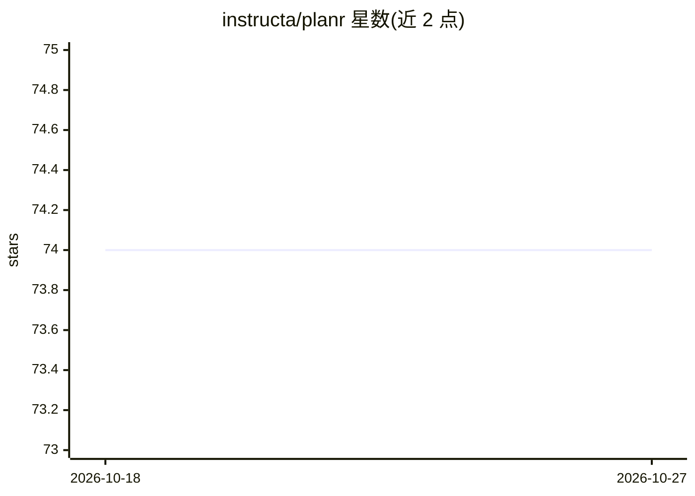

# instructa/planr

⭐ 74 · TypeScript · MIT · 推送 2026-10-20 · [GitHub](https://github.com/instructa/planr) · [官网](https://planr.so) · 组织维护

**给多 coding agent 协作的规划层：Git 内 Markdown 任务与依赖**

面向 agent 构建产品的轻量规划层：任务及其依赖以 Markdown 文件存于 Git 仓库（通常独立于代码库），无数据库、守护进程或 MCP 服务器。CLI 检查文件、找出可开始的工作并更新状态；同时提供 Agent Skill 与插件接入 Claude Code（/planr:planr）、Codex（$planr:planr）、bb 看板及其他 agent（npx skills add）。运行需 Node.js 20+ 与 Git，CLI 自身无运行时依赖；项目自身的编排器负责构建，planr 只负责说明下一步。

## 筛选速览

| 维度 | 判定 | 备注 |
|---|---|---|
| AI 角色 | `ai-ecosystem` | LLM/agent 周边工具 |
| 许可风险 | `permissive` | MIT |
| 部署形态 | `library` | 以包/库形式分发 |
| 模型依赖 | — | README 未给出锁定关系 |
| 硬件要求 | — | 无带数字的原话,不猜 |
| 安装摩擦 | `low` | 无编译、无系统依赖或容器化 |
| 成熟度 | — | 结构信号不足 |

## 能力要点

- 任务与依赖以 Markdown 存于 Git，无数据库/守护进程/MCP 服务器
- CLI 检查文件、查找就绪工作并更新任务状态
- 支持 Claude Code / Codex / bb 等插件与通用技能安装（npx skills add）
- CLI 无运行时依赖，需 Node.js 20+ 与 Git

## 适用场景

- 多个 coding agent 共同开发一个产品时查看任务就绪/阻塞状态
- 把规划文件与代码库分离并保持私有
- 通过看板跟踪 agent 工作进度并审批

## 场景标签

`多智能体` · 领域:Agent 开发

## 证据(README 行号)

> L3: A small planning layer for agent-built products, using Markdown files in Git.
> L27: - Claude Code. Call the skill with `/planr:planr`.
> L31: - CLI. Check files, find ready work & update status. Install it with `npm install -g planr`

## 星数曲线

2026-10-18 74 → 2026-10-27 74（+0）

---
*卡片 v1 · prompt 1.4 · 生成 2026-10-24 · 置信度 high · 依据 README sha `ace528245d79` · [字段定义](../../DATASET.md)*
