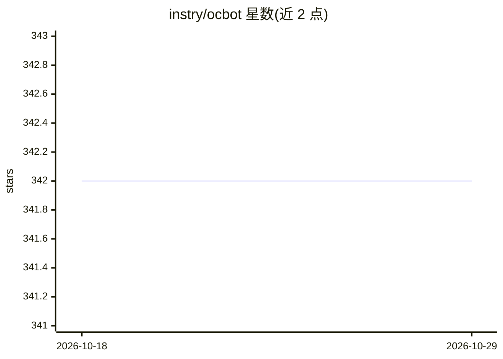

# instry/ocbot

⭐ 342 · TypeScript · NOASSERTION · 推送 2026-04-01 · [GitHub](https://github.com/instry/ocbot) · 个人维护 · 中文 README

**内嵌 OpenClaw 运行时的 AI 原生浏览器，面向 Web4 代理**

基于修改版 Chromium 内核的 AI 原生浏览器，内嵌 OpenClaw agent 运行时，无需配置即可获得浏览、行动、交易能力；支持 OpenClaw 生态的技能、工具与远程 IM 通道，代理与定时任务在窗口关闭后仍后台运行。面向 Web4（AI 代理自主浏览与交易）场景，内置 ERC-8004 链上身份与 x402 微支付，代理可直接支付 API、服务与内容。提供 macOS/Windows 安装包，开发构建需 Python 3、Node.js、Depot Tools（Windows 未测试）。

## 筛选速览

| 维度 | 判定 | 备注 |
|---|---|---|
| AI 角色 | `ai-native` | 本体是模型或模型工具 |
| 许可风险 | `permissive` | NOASSERTION |
| 部署形态 | `desktop` | 安装包/桌面程序 |
| 模型依赖 | — | README 未给出锁定关系 |
| 硬件要求 | — | 无带数字的原话,不猜 |
| 安装摩擦 | `low` | 无编译、无系统依赖或容器化 |
| 成熟度 | — | 结构信号不足 |

## 能力要点

- 修改版 Chromium 内核原生集成 AI 支持（非扩展）
- 内嵌 OpenClaw 运行时，开箱即用全部生态能力
- ERC-8004 链上身份与 x402 微支付
- 代理与定时任务后台常驻运行

## 适用场景

- 让 AI 代理代替我浏览网页并完成任务
- 在浏览器内直接使用 OpenClaw 技能与工具
- 让代理用链上微支付调用付费 API 与内容服务

## 场景标签

`浏览器自动化` · 领域:效率与自动化

## 证据(README 行号)

> L9: Ocbot is built for this future. It natively embeds the OpenClaw runtime and AI-Native Browser, providing a fully cap
> L22: - **Deep Kernel Integration**: Not an extension. Modified Chromium kernel for native AI support and deeper control.

## 星数曲线

2026-10-18 342 → 2026-10-29 342（+0）

---
*卡片 v1 · prompt 1.4 · 生成 2026-10-21 · 置信度 high · 依据 README sha `c5fee1ae996e` · [字段定义](../../DATASET.md)*
