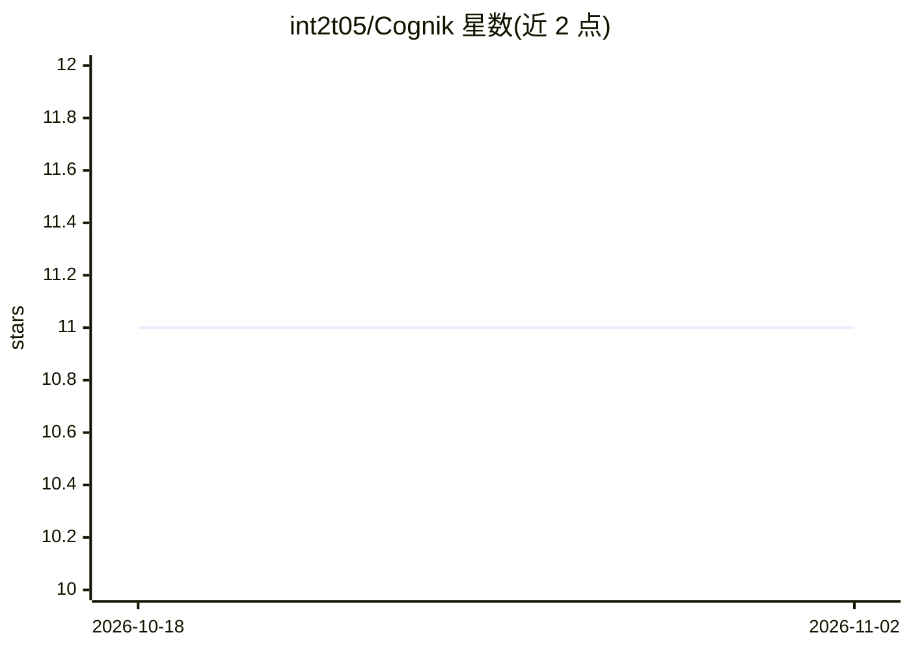

# int2t05/Cognik

⭐ 11 · Go · MIT · 推送 2026-09-06 · [GitHub](https://github.com/int2t05/Cognik) · 个人维护 · 中文 README

**自托管 Agentic RAG 知识库：自动采集、检索并回写知识**

私有部署的知识库应用：检索采用 BM25 + pgvector 混合并经 RRF 融合、cross-encoder 重排与 CRAG 充分性评估；当检索出现缺口时，agent 执行网络搜索、抓取页面、抽取知识并自动发布回 RAG 管线，下一轮即可检索到新知识，配合语义去重。支持会话与全局记忆、工单式人工审核（JWT + RBAC）。后端 Go + Gin + GORM，前端 Next.js，通过 Docker Compose 或 All-in-One 镜像部署，可接入任意 OpenAI 兼容 API 并支持本地 llama.cpp 推理。

## 筛选速览

| 维度 | 判定 | 备注 |
|---|---|---|
| AI 角色 | `ai-native` | 本体是模型或模型工具 |
| 许可风险 | `permissive` | MIT |
| 部署形态 | `self-host` | docker 或自建部署 |
| 模型依赖 | — | README 未给出锁定关系 |
| 硬件要求 | — | 无带数字的原话,不猜 |
| 安装摩擦 | `low` | 无编译、无系统依赖或容器化 |
| 成熟度 | — | 结构信号不足 |

## 能力要点

- 自迭代 agent 循环：web 搜索→抓取→抽取→自动回写发布进 RAG
- 自研 RAG 引擎：BM25 + pgvector 混合、RRR 融合、cross-encoder 重排、CRAG 评估（不依赖 LangChain）
- 六阶段上下文压缩与会话/全局记忆系统
- 上传与元数据缺口自动生成人工审核工单

## 适用场景

- 在自有服务器上搭建持续更新、无需手动上传文档的知识库
- 让 AI 回答基于可自动补充的最新网络资料
- 通过工单流程对 agent 采集的知识做人工审核

## 场景标签

`知识库管理` `RAG` · 领域:知识与检索

## 证据(README 行号)

> L5:  Self-hosted Agentic RAG knowledge base — an AI agent that captures, retrieves, and writes back knowledge automatica
> L18: Cognik is different: **the agent writes back**. It searches the web, fetches pages, extracts knowledge, and publish
> L23: ask → retrieve (BM25 + pgvector + RRF + rerank + CRAG)

## 星数曲线

2026-10-18 11 → 2026-11-02 11（+0）

---
*卡片 v1 · prompt 1.4 · 生成 2026-11-02 · 置信度 high · 依据 README sha `6778526d4aec` · [字段定义](../../DATASET.md)*
