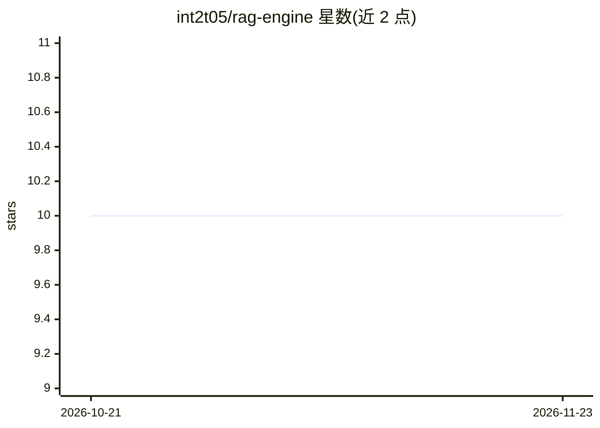

# int2t05/rag-engine

⭐ 10 · TypeScript · MIT · 推送 2026-05-21 · [GitHub](https://github.com/int2t05/rag-engine) · [官网](https://rag.int2t.com) · 个人维护 · 中文 README

**开发者的 RAG 全栈工程模板：认证到评估闭环**

FastAPI + LangChain LCEL + Next.js 14 的检索增强生成全栈模板，覆盖用户认证（JWT）、知识库与文档管理、解析向量化、混合检索（稠密 + BM25/RRF）、FlashRank 重排、SSE 流式对话与可选 RAGAS 评估。数据面分三层：MySQL 存业务元数据、Chroma 存向量、MinIO 存原始文件；LLM/Embedding 配置存数据库，支持 OpenAI 兼容 API 与 Ollama 后端切换。检索策略经 RagPipelineOptions 统一开关，面向二次开发起点。

## 筛选速览

| 维度 | 判定 | 备注 |
|---|---|---|
| AI 角色 | `ai-ecosystem` | LLM/agent 周边工具 |
| 许可风险 | `permissive` | MIT |
| 部署形态 | `self-host` | docker 或自建部署 |
| 模型依赖 | local-ok | 支持本地模型 |
| 硬件要求 | — | 无带数字的原话,不猜 |
| 安装摩擦 | `low` | 无编译、无系统依赖或容器化 |
| 成熟度 | — | 结构信号不足 |

## 能力要点

- 端到端闭环：认证→知识库处理→向量检索→流式对话→RAGAS 评估
- RagPipelineOptions 可配置查询重写、混合检索、多路召回、FlashRank 重排、父子分块展开
- LLM/Embedding 的 Endpoint 与密钥存数据库，支持 OpenAI 兼容 API 与 Ollama 切换
- MySQL + Chroma + MinIO 三层存储分离

## 适用场景

- 作为 RAG 系统二次开发的起点模板
- 搭建带用户认证与多知识库的问答服务
- 用 RAGAS 对检索回答质量做评估

## 场景标签

`RAG` `模型评测` · 领域:评测与运维

## 证据(README 行号)

> L10: **检索增强生成（RAG）全栈工程模板** — 从用户认证、知识库管理、文档解析与向量化，到混合检索、流式对话与 RAGAS 评估，一个仓库闭环跑通。
> L16: - **端到端可运行**：认证 → 知识库/文档处理 → 向量检索 → 流式对话（SSE）→ 可选评估，全链路闭环，适合作为二次开发的起点。

## 星数曲线

2026-10-21 10 → 2026-11-23 10（+0）

---
*卡片 v1 · prompt 1.4 · 生成 2026-11-19 · 置信度 high · 依据 README sha `16c54330365b` · [字段定义](../../DATASET.md)*
