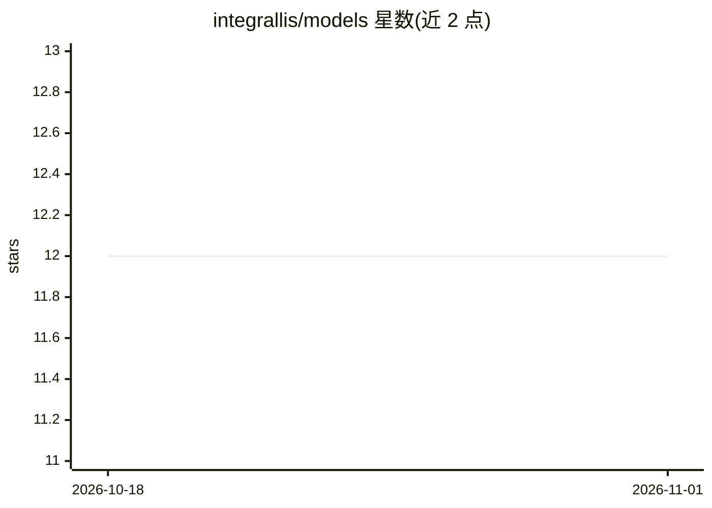

# integrallis/models

⭐ 12 · Java · Apache-2.0 · 推送 2026-10-31 · [GitHub](https://github.com/integrallis/models) · [官网](https://integrallis.github.io/models/) · 组织维护

**Java 进程内小语言模型推理库：无需 Python 或模型服务直接生成文本**

面向 Java 25+ 应用的进程内推理库：读取 GGUF、Safetensors 与 Needle 2 CACT 工件，在 JVM 内执行分词、前向计算、KV 缓存与采样流式输出，纯 Java 后端基于 Vector API 做 CPU SIMD。提供三个可选后端：backend-cuda 以自带 PTX 的 Rust 内核在 NVIDIA GPU 加速、backend-native 用 FFM 替换瓶颈内核、backend-apple 经 FFM 调用 Apple Silicon 系统 SystemLanguageModel。支持 30 个模型身份的文本生成、嵌入、重排、TTS、工具调用与 LangChain4j/Spring AI 集成。通过 Gradle 依赖安装，支持以 ModelJars 门面拉取带资质记录的指定工件；部分模型仅达 USABLE 层级，工具任务资质未通过。

## 筛选速览

| 维度 | 判定 | 备注 |
|---|---|---|
| AI 角色 | `ai-ecosystem` | LLM/agent 周边工具 |
| 许可风险 | `permissive` | Apache-2.0 |
| 部署形态 | `None` |  |
| 模型依赖 | — | README 未给出锁定关系 |
| 硬件要求 | — | 无带数字的原话,不猜 |
| 安装摩擦 | `medium` | 含编译或系统依赖之一 |
| 成熟度 | — | 结构信号不足 |

## 能力要点

- GGUF/Safetensors/CACT 解析与纯 Java 推理管线（Vector API SIMD）
- CUDA/FFM/Apple Silicon 三个可选后端，Java 图保持进程内
- 文本生成、嵌入、跨编码器重排、TTS、工具调用与守护式 RAG
- LangChain4j 与 Spring AI 集成及 ModelJars 限定工件目录

## 适用场景

- Java 应用内嵌本地 LLM 推理，不依赖 Python 或独立模型服务
- Spring/LangChain4j 项目中接入本地文本生成、嵌入与重排
- 在 Apple Silicon 上调用 Apple 系统模型并复用同一生成契约

## 场景标签

`推理引擎` · 领域:训练与推理

## 证据(README 行号)

> L21: Models is an in-process inference library for Java applications. It loads an
> L34: - `backend-java` executes every inference kernel in Java.

## 星数曲线

2026-10-18 12 → 2026-11-01 12（+0）

---
*卡片 v1 · prompt 1.4 · 生成 2026-11-01 · 置信度 high · 依据 README sha `2f32b5ac3926` · [字段定义](../../DATASET.md)*
