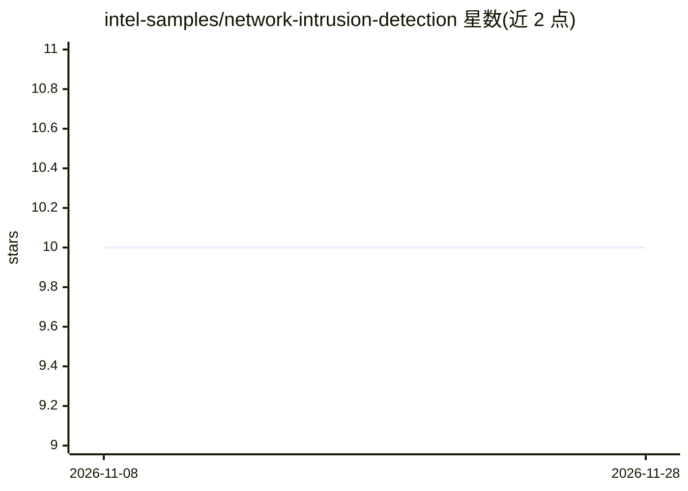

# intel-samples/network-intrusion-detection

⭐ 10 · Python · BSD-3-Clause · 推送 2026-03-11 · [GitHub](https://github.com/intel-samples/network-intrusion-detection) · 组织维护

**面向安全分析师的网络入侵检测机器学习示例套件**

Intel 提供的参考实现套件，演示如何用 scikit-learn 构建网络入侵检测系统：读取 LUFlow 网络流量遥测数据（来自 Kaggle），经特征工程后训练 Random Forest 分类器，将流量分类为 benign、malicious 或 outlier，输出各类型的概率。提供原始 scikit-learn 与 Extension for scikit-learn（sklearnex 加速）两种执行路径，脚本覆盖训练、评估与超参数调优。默认参数针对服务器级硬件设计；消费级硬件可启用 subsample 选项降至 8GB 内存运行，但样本量缩小后结果质量降低。

## 筛选速览

| 维度 | 判定 | 备注 |
|---|---|---|
| AI 角色 | `ai-native` | 本体是模型或模型工具 |
| 许可风险 | `permissive` | BSD-3-Clause |
| 部署形态 | `library` | 以包/库形式分发 |
| 模型依赖 | — | README 未给出锁定关系 |
| 硬件要求 | — | 无带数字的原话,不猜 |
| 安装摩擦 | `low` | 无编译、无系统依赖或容器化 |
| 成熟度 | — | 结构信号不足 |

## 能力要点

- 基于 scikit-learn Random Forest 的三分类入侵检测模型
- --sklearnex=1 启用 Extension for scikit-learn 加速拟合与预测
- 使用 Kaggle LUFlow 数据集（单日超百万行流量记录）
- 包含训练、评估、超参数调优的完整脚本流程

## 适用场景

- 在自有网络流量数据上参考构建入侵检测分类模型
- 对比 scikit-learn 与 sklearnex 加速版的运行表现
- 学习网络流量数据的特征工程与随机森林分类流程

## 场景标签

`网络安全` · 领域:学习与行业

## 证据(README 行号)

> L8: The goal of this example is to demonstrate how a Network Intrusion Detection model could be built from collected dat
> L13: The experiment aimed to build a Network Intrusion Detection System that detects any network intrusions. The main pu
> L145: **Note:** the provided reference implementation with default arguments is meant to be executed on server-grade har

## 星数曲线

2026-11-08 10 → 2026-11-28 10（+0）

---
*卡片 v1 · prompt 1.4 · 生成 2026-11-19 · 置信度 high · 依据 README sha `993c00f7d89c` · [字段定义](../../DATASET.md)*
