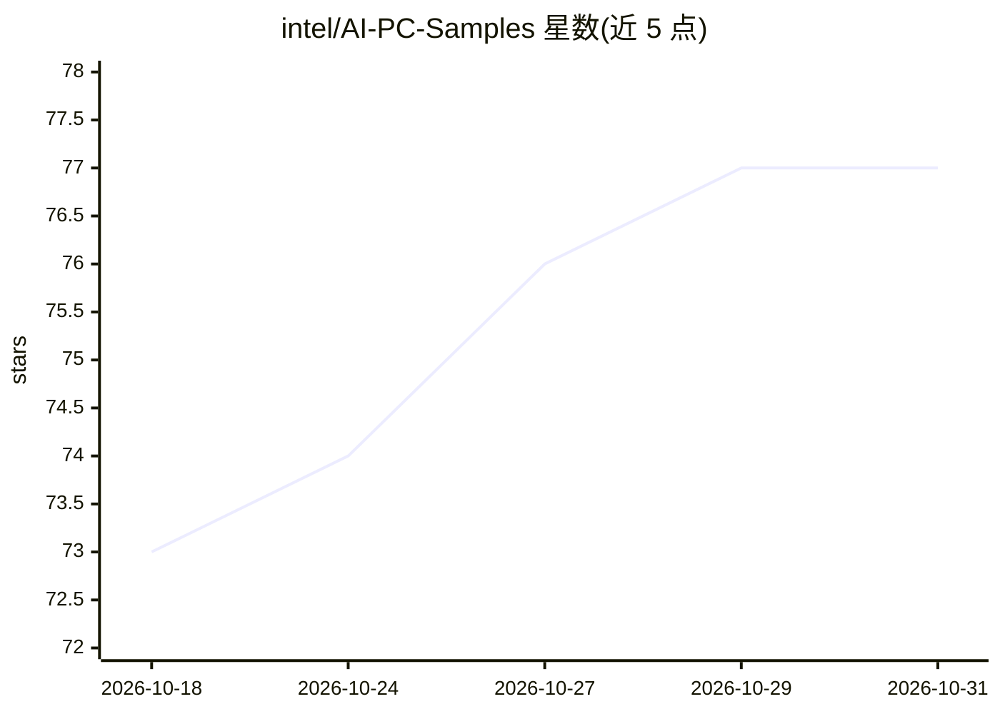

# intel/AI-PC-Samples

⭐ 77 · Jupyter Notebook · MIT · 推送 2026-10-24 · [GitHub](https://github.com/intel/AI-PC-Samples) · 组织维护

**Intel AI PC 上生成式 AI 工作负载的示例笔记本集合**

Intel 维护的示例仓库，收录一组 Jupyter 笔记本，用于在配备 Intel Core Ultra 处理器与 iGPU 的 AI PC（Windows 11）上演示生成式 AI 工作负载。面向 AI 创作者、艺术家、工程师及对生成式 AI 感兴趣的用户。运行前需更新 Intel GPU 驱动、安装 Visual Studio 2022（含 C++ 工作负载）、conda-forge 与 CMake；具体安装步骤内嵌于各笔记本中，依赖 Python、PyTorch 与 Jupyter。

## 筛选速览

| 维度 | 判定 | 备注 |
|---|---|---|
| AI 角色 | `ai-knowledge` | 知识聚合/清单类 |
| 许可风险 | `permissive` | MIT |
| 部署形态 | `None` |  |
| 模型依赖 | — | README 未给出锁定关系 |
| 硬件要求 | — | 无带数字的原话,不猜 |
| 安装摩擦 | `low` | 无编译、无系统依赖或容器化 |
| 成熟度 | — | 结构信号不足 |

## 能力要点

- 笔记本形式演示 AI PC 上的生成式 AI 工作负载
- 针对 Intel Core Ultra 处理器与 iGPU 环境（Windows 11）
- 各笔记本内置安装步骤与使用指南

## 适用场景

- 在 Intel AI PC 上动手学习生成式 AI 示例
- 了解生成式 AI 工作负载在 iGPU 上的运行方式
- 工程师参考笔记本搭建本地 GenAI 环境

## 场景标签

`教程课程` · 领域:学习与行业

## 证据(README 行号)

> L3: Welcome to the AI PC GenAI Samples Repository.This repository features a curated collection of notebooks designed to
> L15: - Intel® Core™ Ultra Processor - Windows 11.

## 星数曲线

2026-10-18 73 → 2026-10-31 77（+4）

---
*卡片 v1 · prompt 1.4 · 生成 2026-10-24 · 置信度 high · 依据 README sha `266e25b21239` · [字段定义](../../DATASET.md)*
