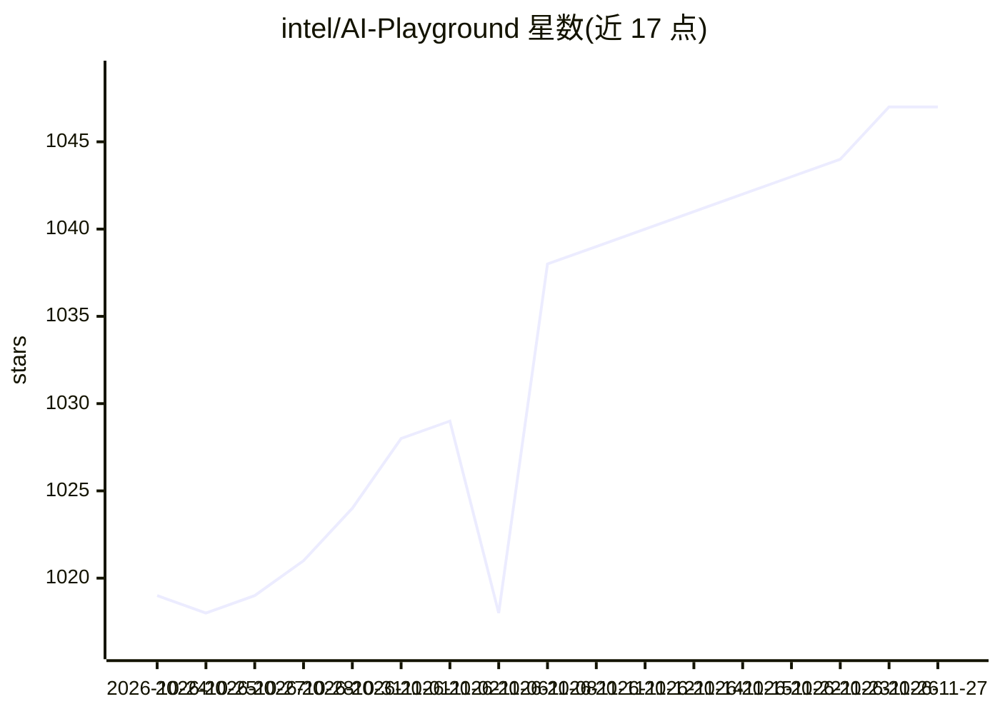

# intel/AI-Playground

⭐ 1,047 · TypeScript · MIT · 推送 2026-10-30 · [GitHub](https://github.com/intel/AI-Playground) · 组织维护

**面向 Intel AI PC 用户的离线生成式 AI 应用套件**

Intel 开源的 AI PC 生成式 AI 应用套件，覆盖聊天助手、图像生成/编辑、视频生成、语音（语音转文字/文字转语音）、文档 RAG、代码辅助与 MCP 工具调用，通过 Llama.cpp（Vulkan/GGUF）与 OpenVINO 后端在本地离线运行模型，也可选 Hybrid Cloud 模式凭 API key 调用云端前沿模型。目标硬件为 Intel Core Ultra/Arc GPU（8GB+ vRAM），另有实验性 NVIDIA CUDA 模式。提供 Windows/Linux 打包安装器，源码方式需 Node.js ≥20 并通过 npm 脚本安装、获取外部资源后运行。

## 筛选速览

| 维度 | 判定 | 备注 |
|---|---|---|
| AI 角色 | `ai-native` | 本体是模型或模型工具 |
| 许可风险 | `permissive` | MIT |
| 部署形态 | `desktop` | 安装包/桌面程序 |
| 模型依赖 | local-ok | 支持本地模型 |
| 硬件要求 | — | 无带数字的原话,不猜 |
| 安装摩擦 | `high` | 编译与系统依赖俱全 |
| 成熟度 | `idea` | |

## 能力要点

- 聊天/图像生成/图像编辑/视频生成/语音/文档 RAG 一体应用
- Llama.cpp 与 OpenVINO 双本地后端，Model Manager 浏览与下载模型
- 工具调用与 MCP 连接内置媒体工具及外部应用（如 Blender）
- Home Agent 可经 Telegram、Slack 或 LAN 网页远程访问家中 PC

## 适用场景

- 在 Intel Arc/Core Ultra PC 上离线运行聊天与 RAG 问答
- 本地生成与编辑图像、生成视频片段
- 无需安装多个 AI 后端框架，一个应用内使用多种生成式功能
- 通过手机上的 Telegram/Slack 远程操控家中 PC 运行 AI 任务

## 场景标签

`AI 助手` `图像生成` `视频生成` `RAG` · 领域:对话与助手

## 证据(README 行号)

> L9: Welcome to AI Playground open source project and AI PC generative AI application suite. This application provides a 
> L16: As a local alternative to cloud AI services, AI Playground is intended to give consumers and AI curious prosumers e
> L17: - Chat Assistant: One preset for vision, reasoning, document RAG, tool calling, and MCP—run image, video, and editi

## 星数曲线

2026-10-24 1,019 → 2026-11-27 1,047（+28）

---
*卡片 v1 · prompt 1.4 · 生成 2026-11-25 · 置信度 high · 依据 README sha `1b2f1ee8c8b4` · [字段定义](../../DATASET.md)*
