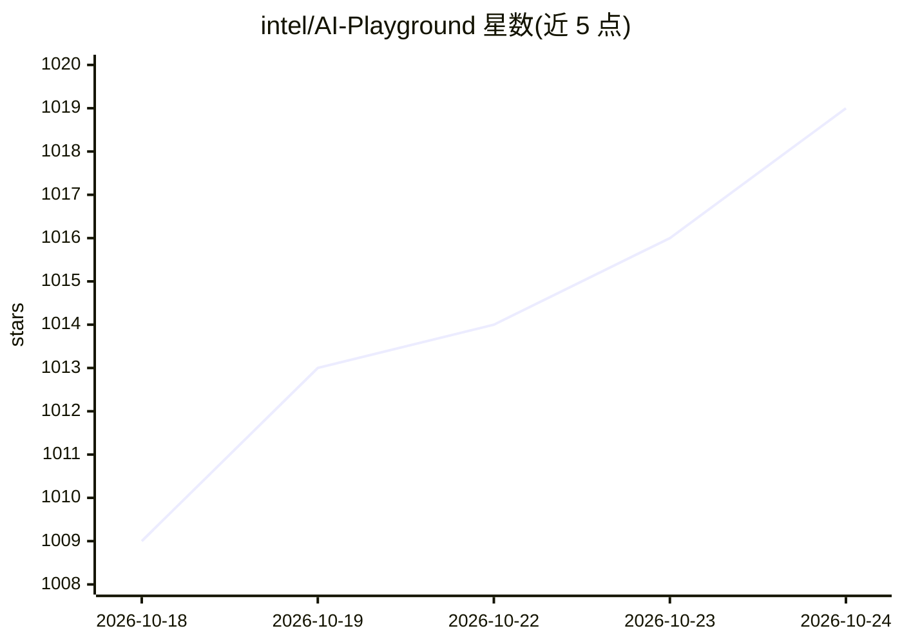

# intel/AI-Playground

⭐ 1,019 · TypeScript · MIT · 推送 2026-10-01 · [GitHub](https://github.com/intel/AI-Playground) · 组织维护

**Intel AI PC 上的本地生成式 AI 套件：聊天、图像与视频生成**

Intel 开源的开源桌面应用套件，面向消费者与 AI 尝鲜用户，在搭载 Intel Arc GPU 的 PC 上离线运行聊天助手、图像生成/编辑、视频生成、语音转文字、文档 RAG 与代码辅助等生成式 AI 功能。模型侧整合 PyTorch 图像扩散模型（SD1.5/SDXL/Flux 等）与 GGUF/OpenVINO LLM，安装器首次运行时下载 Llama.cpp、OpenVINO、ComfyUI 等后端。可选 Hybrid Cloud 模式经用户 API key 接入 ChatGPT、Claude、Gemini、Grok。提供 Windows/Linux 打包安装器与源码开发路径；NVIDIA RTX 与 Linux 支持标注为实验性。

## 筛选速览

| 维度 | 判定 | 备注 |
|---|---|---|
| AI 角色 | `ai-native` | 本体是模型或模型工具 |
| 许可风险 | `permissive` | MIT |
| 部署形态 | `desktop` | 安装包/桌面程序 |
| 模型依赖 | local-ok | 支持本地模型 |
| 硬件要求 | — | 无带数字的原话,不猜 |
| 安装摩擦 | `high` | 编译与系统依赖俱全 |
| 成熟度 | `idea` | |

## 能力要点

- 离线运行聊天、图像生成/编辑、视频生成与文档 RAG，单应用整合多后端
- Model Manager 内浏览、收藏并下载 GGUF/OpenVINO 模型
- Hybrid Cloud 可选模式经用户 API key 接入 ChatGPT/Claude/Gemini/Grok
- Home Agent 支持从 Telegram/Slack/LAN 网页远程调用本机 AI

## 适用场景

- 在 Intel AI PC 上离线做 AI 聊天、画图与改图，不上传个人数据
- 通过对话里的 Agent 预设生成 HTML 小游戏或代码
- 手机上经 Telegram/Slack 远程使用家里 PC 的 AI 能力

## 场景标签

`聊天机器人` `图像生成` `视频生成` `文档问答` · 领域:对话与助手

## 证据(README 行号)

> L9: Welcome to AI Playground open source project and AI PC generative AI application suite. This application provides a 
> L16: As a local alternative to cloud AI services, AI Playground is intended to give consumers and AI curious prosumers e

## 星数曲线

2026-10-18 1,009 → 2026-10-24 1,019（+10）

---
*卡片 v1 · prompt 1.4 · 生成 2026-10-21 · 置信度 high · 依据 README sha `856002cfd6b0` · [字段定义](../../DATASET.md)*
