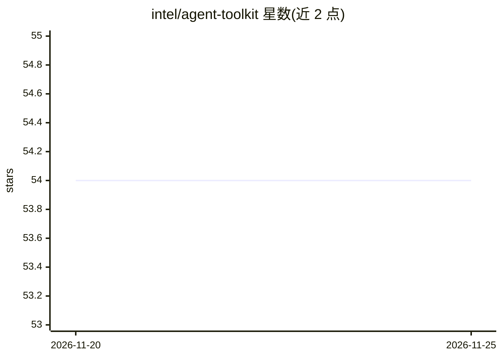

# intel/agent-toolkit

⭐ 54 · Shell · Apache-2.0 · 推送 2026-11-20 · [GitHub](https://github.com/intel/agent-toolkit) · 组织维护

**在 Intel Xeon 上部署企业级 Agentic AI 基础设施的工具包**

面向需要在 Intel Xeon 与加速器上从原型走向生产的组织：以 Kubernetes 平台形式打包 API 网关（LiteLLM）、推理路由（vLLM/SGLang）、代理内存（Redis/pgvector）、沙箱代码执行、MCP 工具集成与可观测性（Langfuse/Prometheus/Grafana）等七个可插拔 provider 块，全部预集成。通过 es_auto_installer.sh 自动化安装，支持多节点/单节点 K8s 与 Docker Compose 三种部署形态；默认 CPU 推理，可按需加 GPU 或云 LLM。

## 筛选速览

| 维度 | 判定 | 备注 |
|---|---|---|
| AI 角色 | `ai-ecosystem` | LLM/agent 周边工具 |
| 许可风险 | `permissive` | Apache-2.0 |
| 部署形态 | `self-host` | docker 或自建部署 |
| 模型依赖 | local-ok | 支持本地模型 |
| 硬件要求 | — | 无带数字的原话,不猜 |
| 安装摩擦 | `low` | 无编译、无系统依赖或容器化 |
| 成熟度 | — | 结构信号不足 |

## 能力要点

- 七个可插拔 provider 块（网关/推理路由/内存/沙箱/工具/观测/部署），可逐块替换
- 按任务意图智能路由推理：推理规划走 GPU/云，执行协调走 Xeon CPU
- Kata Containers/Firecracker microVM 级沙箱隔离（可选启用）
- 支持 LangGraph、CrewAI、Flowise 等 OpenAI 兼容框架

## 适用场景

- 在企业内网私有化部署一套生产级 agentic AI 基础设施
- 为多智能体应用统一管理 API 网关、内存与可观测性
- 在 Xeon CPU 上控制推理成本，按需路由到 GPU 或云模型
- 为 agent 沙箱化执行不可信代码并做策略管控

## 场景标签

`模型网关` `LLM 可观测性` `Agent 记忆` · 领域:Agent 开发

## 证据(README 行号)

> L9: > **Deploy a production-grade, open source agentic AI stack on Intel® Xeon® in hours — not months.**
> L10: > A batteries-included Kubernetes platform with API gateway, intelligent inference routing, agent memory, sandboxed
> L64: The toolkit is organized into **seven pluggable provider blocks**, each with a default implementation and a defined

## 星数曲线

2026-11-20 54 → 2026-11-25 54（+0）

---
*卡片 v1 · prompt 1.4 · 生成 2026-11-20 · 置信度 high · 依据 README sha `b5817f055dec` · [字段定义](../../DATASET.md)*
