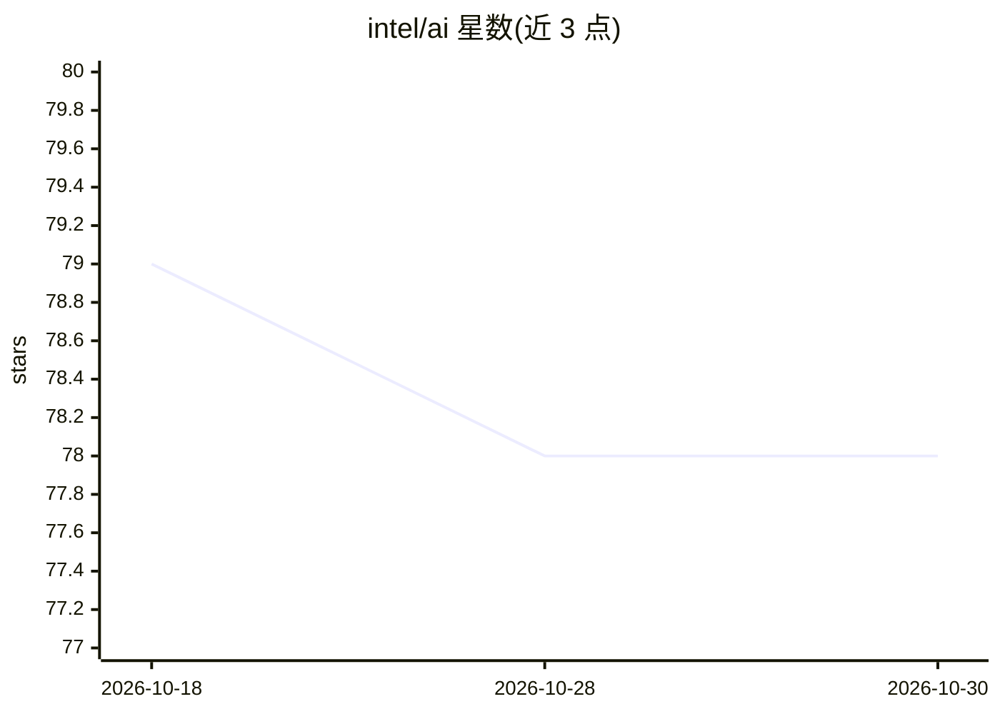

# intel/ai

⭐ 78 · NOASSERTION · 推送 2026-03-27 · [GitHub](https://github.com/intel/ai) · 组织维护

**Intel 开源 AI 软件组合的导览仓库**

Intel 官方仓库，用于导览其开源 AI 软件组合，指向开发、训练与部署 AI 解决方案的工具。README 本体仅两行，包含标识与标题，未提供具体工具清单、安装方式或使用说明；具体内容需依赖仓库内其他文件或外部链接。属于组织级索引/入口类仓库，而非可直接安装运行的产品。

## 筛选速览

| 维度 | 判定 | 备注 |
|---|---|---|
| AI 角色 | `ai-knowledge` | 知识聚合/清单类 |
| 许可风险 | `none` | NOASSERTION |
| 部署形态 | `None` |  |
| 模型依赖 | — | README 未给出锁定关系 |
| 硬件要求 | — | 无带数字的原话,不猜 |
| 安装摩擦 | `low` | 无编译、无系统依赖或容器化 |
| 成熟度 | — | 结构信号不足 |

## 能力要点

- 展示 Intel 开源 AI 软件组合入口
- 覆盖开发、训练、部署环节的工具指向

## 适用场景

- 查找 Intel 提供的开源 AI 工具
- 作为 Intel AI 软件生态的导航起点

## 场景标签

`精选清单` · 领域:学习与行业

## 证据(README 行号)

> L2: # Explore AI Software Solutions with Intel

## 星数曲线

2026-10-18 79 → 2026-10-30 78（-1）

---
*卡片 v1 · prompt 1.4 · 生成 2026-10-24 · 置信度 low · 依据 README sha `eb70c643bb83` · [字段定义](../../DATASET.md)*
