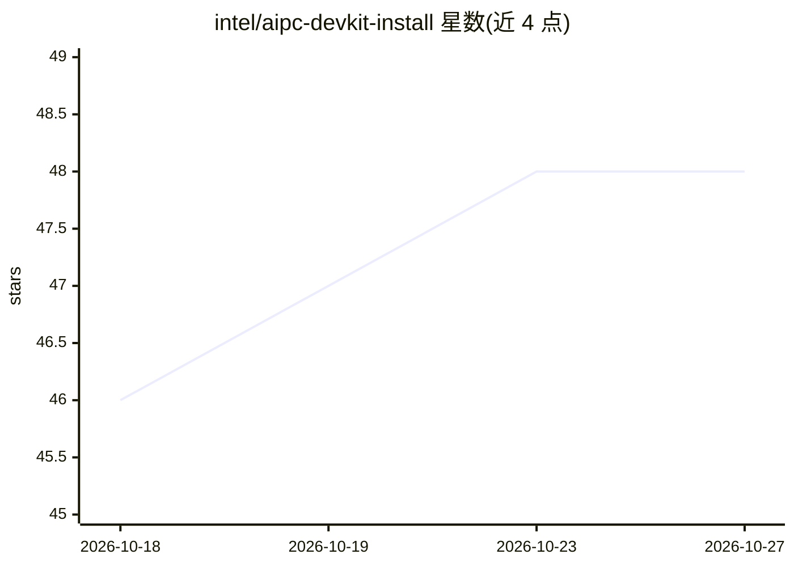

# intel/aipc-devkit-install

⭐ 48 · PowerShell · MIT · 推送 2026-10-23 · [GitHub](https://github.com/intel/aipc-devkit-install) · [官网](https://www.intel.com/content/www/us/en/ai-pc/overview.html) · 组织维护

**统一安装 Intel AI PC 开发环境的一体化安装器**

Intel 维护的 AI PC 应用安装器（v3.0），用于在研讨会、活动与交付场景中标准化 Windows 和 Linux 的开发环境搭建：按依赖顺序安装与配置开发工具和运行时，跟踪已安装组件以支持维护与卸载，并输出日志用于排障与验证。Windows 流程覆盖 VS Code、Python 3.12、Ollama、Intel AI Playground 等 15 项应用；Linux 流程（Ubuntu 24.04）覆盖 Intel GPU/NPU 驱动、OpenVINO 工具链、Ollama 本地 LLM 环境等。具体安装步骤分散在子目录 README 中。限制：仅面向 Intel AI PC 硬件生态。

## 筛选速览

| 维度 | 判定 | 备注 |
|---|---|---|
| AI 角色 | `ai-ecosystem` | LLM/agent 周边工具 |
| 许可风险 | `permissive` | MIT |
| 部署形态 | `None` |  |
| 模型依赖 | — | README 未给出锁定关系 |
| 硬件要求 | — | 无带数字的原话,不猜 |
| 安装摩擦 | `low` | 无编译、无系统依赖或容器化 |
| 成熟度 | — | 结构信号不足 |

## 能力要点

- Windows 与 Linux 统一安装框架，依赖感知的安装顺序
- 安装跟踪与卸载支持，附日志用于排障
- Linux 流程包含 Intel GPU/NPU 驱动与 OpenVINO/OpenVINO GenAI 环境
- Windows 流程覆盖 15 项应用（VS Code、Ollama、Intel AI Playground 等）

## 适用场景

- 为 Intel AI PC 批量搭建标准化开发环境
- 在研讨会或活动中快速完成 Windows/Linux 开发工具链部署
- 配置含 OpenVINO 与 Ollama 的本地 LLM 开发环境

## 场景标签

 · 领域:开发工具/环境配置

## 证据(README 行号)

> L9: The AI PC Application Installer provides a unified way to set up Intel AI PC development environments for engagement
> L60: - Intel GPU and NPU driver setup (Ubuntu 24.04)

## 星数曲线

2026-10-18 46 → 2026-10-27 48（+2）

---
*卡片 v1 · prompt 1.4 · 生成 2026-10-25 · 置信度 high · 依据 README sha `b894914b856a` · [字段定义](../../DATASET.md)*
