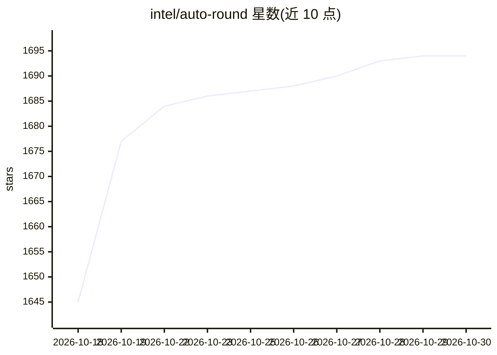

# intel/auto-round

⭐ 1,694 · Python · Apache-2.0 · 推送 2026-10-29 · [GitHub](https://github.com/intel/auto-round) · 组织维护 · 中文 README

**面向 LLM/VLM 的训练后量化工具包，兼顾精度与量化成本**

Intel 维护的 LLM 与视觉语言模型训练后量化（PTQ）工具包，核心算法为 SignRoundV1/V2，支持 W4A16、INT2、MXFP4、NVFP4、FP8 及 GGUF 等低比特色格式，并可用 AutoScheme 在数分钟内生成混合比特方案。提供 CLI 与 Python API，可导出 auto_round/AutoAWQ/AutoGPTQ/GGUF/llm_compressor 多种格式，与 Transformers、vLLM、SGLang 集成，部署覆盖 Intel CPU/XPU、Gaudi 与 NVIDIA GPU。校准默认使用 NeelNanda/pile-10k，量化 7B 模型约需单卡 10 分钟。

## 筛选速览

| 维度 | 判定 | 备注 |
|---|---|---|
| AI 角色 | `ai-ecosystem` | LLM/agent 周边工具 |
| 许可风险 | `permissive` | Apache-2.0 |
| 部署形态 | `desktop` | 安装包/桌面程序 |
| 模型依赖 | local-ok | 支持本地模型 |
| 硬件要求 | — | 无带数字的原话,不猜 |
| 安装摩擦 | `medium` | 含编译或系统依赖之一 |
| 成熟度 | — | 结构信号不足 |

## 能力要点

- SignRoundV1/V2 算法与 W2-W8 多种量化 scheme
- AutoScheme 分钟级生成混合比特/混合精度方案
- 导出 auto_round/AutoAWQ/AutoGPTQ/GGUF/llm_compressor 多格式
- 支持 10+ 视觉语言模型与多 GPU 量化、多校准数据集

## 适用场景

- 把大模型压到 4bit/2bit 以降低部署显存与内存占用
- 生成 GGUF 格式供 llama.cpp 等运行时使用
- 为 vLLM/Transformers/SGLang 部署准备低比特量化模型

## 场景标签

`模型量化` · 领域:训练与推理

## 证据(README 行号)

> L20: AutoRound is an easy-to-use post-training quantization toolkit for Large Language Models (LLMs) and Vision-Language
> L22: AutoRound is designed to deliver strong accuracy at ultra-low bit widths while keeping quantization costs reasonabl
> L23: It integrates with popular ecosystems including Transformers, vLLM, and SGLang, and supports deployment across Inte

## 星数曲线

2026-10-18 1,645 → 2026-10-30 1,694（+49）

---
*卡片 v1 · prompt 1.4 · 生成 2026-10-21 · 置信度 high · 依据 README sha `59cead61b952` · [字段定义](../../DATASET.md)*
