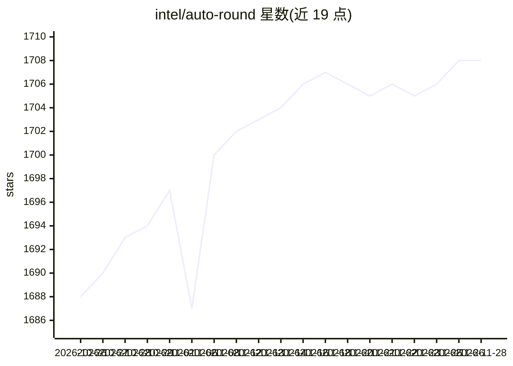

# intel/auto-round

⭐ 1,708 · Python · Apache-2.0 · 推送 2026-11-27 · [GitHub](https://github.com/intel/auto-round) · 组织维护 · 中文 README

**面向 LLM/VLM 的训练后低比特量化工具包**

AutoRound 是面向大语言模型与视觉语言模型的训练后量化工具包，核心算法为 SignRoundV1/V2，支持 WNA16、MXFP4、NVFP4、FP8 等数据类型与 GGUF 导出格式。提供 CLI 与 Python API 两类入口，内置 auto-round-best/light/opt-rtn/rtn 等多种量化配方，支持混合比特方案生成、多 GPU 量化与多种校准数据集。README 称 7B 模型单卡约 10 分钟完成量化。支持 Intel CPU/XPU、Gaudi 与 NVIDIA GPU 部署。

## 筛选速览

| 维度 | 判定 | 备注 |
|---|---|---|
| AI 角色 | `ai-ecosystem` | LLM/agent 周边工具 |
| 许可风险 | `permissive` | Apache-2.0 |
| 部署形态 | `desktop` | 安装包/桌面程序 |
| 模型依赖 | local-ok | 支持本地模型 |
| 硬件要求 | — | 无带数字的原话,不猜 |
| 安装摩擦 | `medium` | 含编译或系统依赖之一 |
| 成熟度 | — | 结构信号不足 |

## 能力要点

- 支持 WNA16、MXFP4、NVFP4、FP8 数据类型与 GGUF 导出格式
- 与 Transformers、vLLM、SGLang 集成
- 提供 auto-round-best/light/opt-rtn/rtn 多种量化配方
- 支持 10+ 视觉语言模型开箱量化

## 适用场景

- 将 LLM/VLM 量化为 2-4 比特以降低部署成本
- 为 vLLM/SGLang 推理生成量化后的模型权重
- 混合比特方案自动生成与低比特精度调优

## 场景标签

`模型量化` · 领域:训练与推理

## 证据(README 行号)

> L20: AutoRound is an easy-to-use post-training quantization toolkit for Large Language Models (LLMs) and Vision-Language
> L23: It integrates with popular ecosystems including Transformers, vLLM, and SGLang, and supports deployment across Inte
> L74: Seamlessly works with **Transformers, vLLM, SGLang** and more.

## 星数曲线

2026-10-26 1,688 → 2026-11-28 1,708（+20）

---
*卡片 v1 · prompt 1.4 · 生成 2026-11-28 · 置信度 high · 依据 README sha `0bc0f5988499` · [字段定义](../../DATASET.md)*
