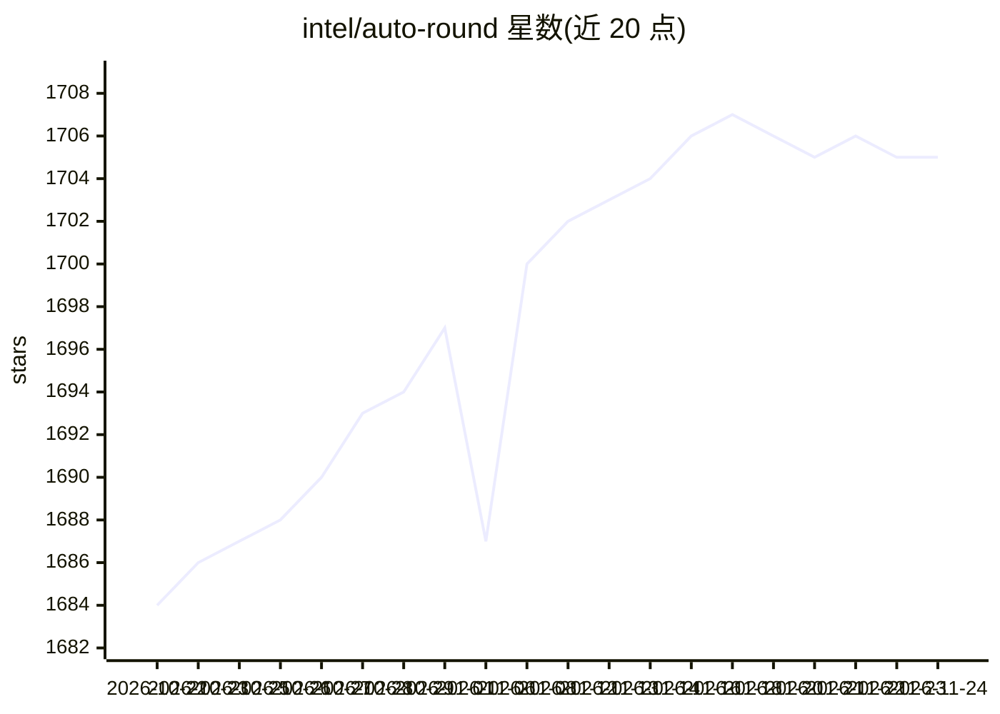

# intel/auto-round

⭐ 1,706 · Python · Apache-2.0 · 推送 2026-11-24 · [GitHub](https://github.com/intel/auto-round) · 组织维护 · 中文 README

**LLM/VLM 训练后量化工具包，低比特压缩部署**

面向大语言模型与视觉语言模型的训练后量化工具包，提供 SignRoundV1/V2 等低比特与自适应比特算法，支持 WNA16、MXFP4、NVFP4、FP8 数据类型及 GGUF 格式，可导出 AutoRound/AutoAWQ/AutoGPTQ/GGUF 多种格式。与 Transformers、vLLM、SGLang 集成，部署目标覆盖 Intel CPU/XPU、Gaudi 加速器与 NVIDIA GPU。提供 CLI 与 Python API，多档 recipe（best/light/opt-rtn/rtn）平衡耗时与精度，7B 模型单 GPU 约 10 分钟完成量化。

## 筛选速览

| 维度 | 判定 | 备注 |
|---|---|---|
| AI 角色 | `ai-ecosystem` | LLM/agent 周边工具 |
| 许可风险 | `permissive` | Apache-2.0 |
| 部署形态 | `desktop` | 安装包/桌面程序 |
| 模型依赖 | local-ok | 支持本地模型 |
| 硬件要求 | — | 无带数字的原话,不猜 |
| 安装摩擦 | `medium` | 含编译或系统依赖之一 |
| 成熟度 | — | 结构信号不足 |

## 能力要点

- 支持 W2A16 至 W8A8、MXFP4/NVFP4/FP8 及 GGUF 导出格式
- 多档量化 recipe：auto-round-best/light/opt-rtn/rtn 可按成本选择
- 与 Transformers、vLLM、SGLang 集成，支持 10+ 运行时后端
- 支持多 GPU 量化、多校准数据集与 AutoScheme 混合比特方案生成

## 适用场景

- 将 LLM/VLM 量化到 INT4/INT2 用于本地或服务端部署
- 为 vLLM/SGLang 推理服务生成低比特模型
- 在 Intel Xeon/Gaudi/NVIDIA GPU 上做量化实验与精度评估

## 场景标签

`模型量化` · 领域:训练与推理

## 证据(README 行号)

> L20: AutoRound is an easy-to-use post-training quantization toolkit for Large Language Models (LLMs) and Vision-Language
> L23: It integrates with popular ecosystems including Transformers, vLLM, and SGLang, and supports deployment across Inte
> L101: ## Installation

## 星数曲线

2026-10-22 1,684 → 2026-11-24 1,705（+21）

---
*卡片 v1 · prompt 1.4 · 生成 2026-11-23 · 置信度 high · 依据 README sha `2ec75f8eedc6` · [字段定义](../../DATASET.md)*
