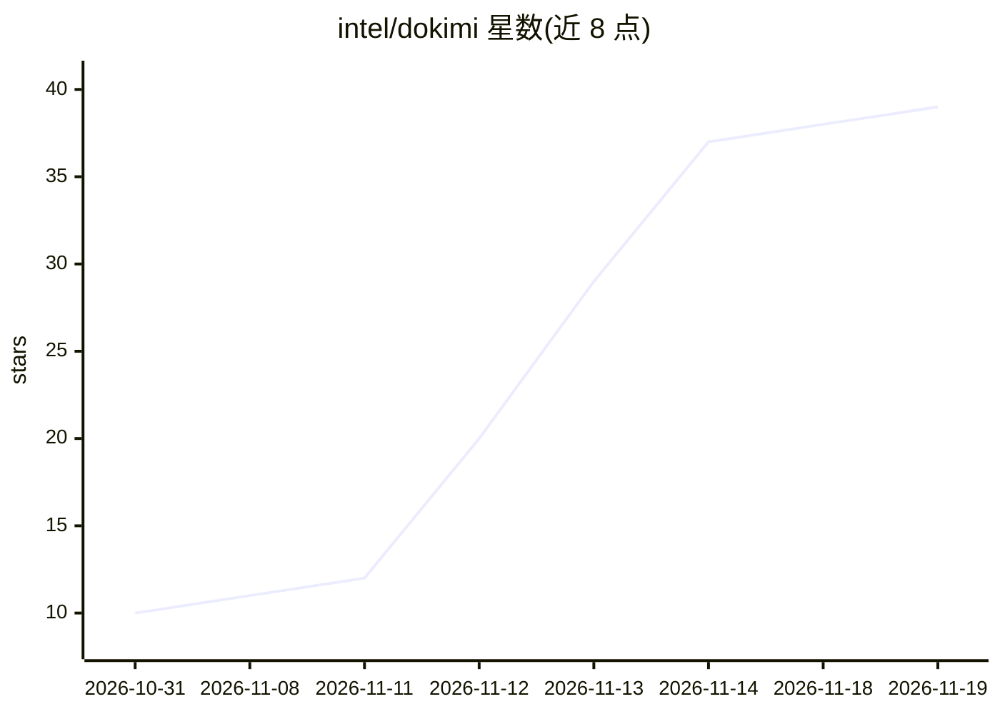

# intel/dokimi

⭐ 39 · Python · Apache-2.0 · 推送 2026-11-18 · [GitHub](https://github.com/intel/dokimi) · 组织维护

**面向编码智能体的 A/B 测试评测工具：测技能与文档是否有效**

Dokimi 对编码智能体的上下文物（skills、MCP 文档、仓库指令、agent profile）做配对 on/off 对照实验：同一评测集在改动前后各跑一遍，由同一 grader 打分，以差值与 p-value 判定效果。提供 novelty 分析（逐条声明带/不带技能各问一次、由另一模型评分，落入 added/redundant/missing/degraded 四格）与不调用 LLM 的仓库静态扫描。以 Python 包与 CLI 形式提供，需 Python 3.11+；agent 实验需所选 provider 或已登录 harness，可执行编码任务还需受支持的容器环境。Apache-2.0 许可，由 Intel 维护。

## 筛选速览

| 维度 | 判定 | 备注 |
|---|---|---|
| AI 角色 | `ai-ecosystem` | LLM/agent 周边工具 |
| 许可风险 | `permissive` | Apache-2.0 |
| 部署形态 | `library` | 以包/库形式分发 |
| 模型依赖 | — | README 未给出锁定关系 |
| 硬件要求 | — | 无带数字的原话,不猜 |
| 安装摩擦 | `low` | 无编译、无系统依赖或容器化 |
| 成熟度 | — | 结构信号不足 |

## 能力要点

- 同一评测集的配对对照实验，以差值和 p-value 判定上下文物效果
- 技能声明级 novelty 分析：四格（added/redundant/missing/degraded）逐模型判定
- dokimi repo scan 静态扫描不调用 LLM，支持技能目录检查（catalog check）
- 39 张功能卡片区分已实现功能与开放 PR/研究方向

## 适用场景

- 验证我写的 agent 技能是否真的提升任务表现
- 审查仓库指令和文档对编码智能体是否被加载和生效
- 换模型或 harness 后重新度量既有技能与基线

## 场景标签

`模型评测` · 领域:评测与运维

## 证据(README 行号)

> L7: Find out whether your agent's skills, documentation and repository instructions improve its work. Dokimi runs the sa
> L9: The same eval set runs on agent A as it is and on agent B with one change; the same grader scores both, and the diff

## 星数曲线

2026-10-31 10 → 2026-11-19 39（+29）

---
*卡片 v1 · prompt 1.4 · 生成 2026-11-18 · 置信度 high · 依据 README sha `dc90c89aea55` · [字段定义](../../DATASET.md)*
